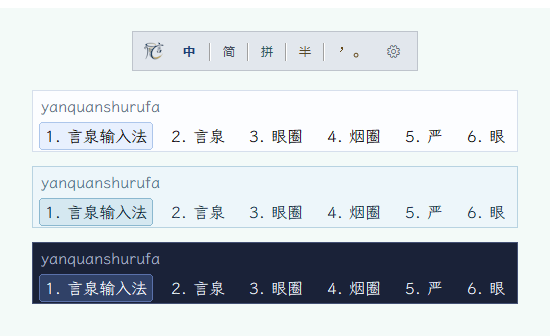

# Cassotis IME

<p align="center">
  
</p>

<p align="center">
  <a href="https://www.yanquan.org">
    <picture>
      <source media="(prefers-color-scheme: dark)" srcset="readme_slogan_dark.svg">
      
    </picture>
  </a>
</p>

<p align="center">
  <a href="https://www.yanquan.org"></a>
  <a href="https://github.com/shenmin/cassotis-ime/releases/latest"></a>
  <a href="LICENSE"></a>
</p>
<p align="center">
  
</p>

**[Website: www.yanquan.org](https://www.yanquan.org)** | English | [简体中文](README.zh-Hans.md) | [繁體中文](README.zh-Hant.md) | [Linux version](https://github.com/shenmin/cassotis-ime-linux) | [macOS version](https://github.com/shenmin/cassotis-ime-mac)

Cassotis IME (言泉输入法) is an experimental Chinese Pinyin input method for Windows 10/11, built primarily with Delphi on top of TSF (Text Services Framework). Candidate ranking runs entirely on the local CPU, around a single character-level language model trained by the project. It shows no ads, bundles no software and uploads nothing you type: dictionaries, settings and what it learns stay on the computer.

The project focus is:
- build a stable TSF-based IME foundation,
- keep the architecture modular (TSF DLL + host process + tools),
- rank long sentences, short words and completions with one local language model and a small set of corpus-trained rankers.

## Name Origin
The English name **Cassotis** comes from the sacred spring inside the Temple of Delphi. Before delivering oracles, the priestess Pythia was said to drink from this spring to enter a prophetic state. The spring was regarded as the true source of prophecy and inspiration, where oracles were born, which resonates with the path from Delphi to human language.

The Chinese name **言泉** (Yanquan, "Spring of Words") matches Cassotis as a prophetic spring, while also carrying the meaning of **言如泉涌** ("words flowing like a spring"), reflecting our expectation of a fluent and intelligent input experience.

## Features
- **TSF text service.** Registration, activation and the composition lifecycle are in place, including the TSF COM-less capability category for hosts that use that activation path. The TSF DLL is built for Win64 and Win32 (`svr.dll` / `svr32.dll`); the host process is Win64 only.
- **Candidate window.** Paging, selection and text commitment, with an optional expanded view showing up to three rows when paging. Number keys select from the active row; the Tab completion area is unchanged. By default the window lines up with the start of the input and stays there while typing; Candidate position in Appearance settings makes it follow the caret instead. Optionally, `;` and `'` pick the second and third candidate while pinyin is being typed and stay punctuation otherwise (Shortcuts settings, off by default). A right click on the window opens the same menu as the tray icon, and the Pinyin being typed stays.
- **English recognition.** In Chinese full-Pinyin, half-width mode, letters that are an English word or name (`pro`, `markdown`, `Effie`), that are typed with a capital, or that were committed as letters before appear before the numbered candidates. When the input has no Chinese reading as a whole they are selected and Space commits them as typed; when it has one (`bug`, `mac`), the language model weighs the letters against it with the preceding text and selects them, shows them unselected, or leaves the candidates alone. Chinese selection numbers stay unchanged. Enabled by default and optional in General settings; Double Pinyin keeps its normal behavior.
- **Mode label beside the caret.** Switching between Chinese and English (Shift by default, the configured shortcut, or the taskbar's input indicator) briefly shows the Cassotis mark and 中 or 英 just above the caret, and so does switching to Cassotis from another input method (Win+Space, Alt+Shift, or the taskbar's input indicator). A text field that takes the focus in English mode gets the same reminder, since English types letters without any sign of the input method; Chinese mode shows itself with the first key. The label takes neither the focus nor clicks, goes away with the next key, and is not shown in password fields or where the caret cannot be located. On by default and optional in Appearance settings.
- **One-key completion**, original to Cassotis. Exactly one trusted continuation is shown and accepted with the configured key. Exact completions from the user and base dictionaries and offline-vetted strong-transition completions appear at once; the language model then reranks them in the background, using the text before the cursor when there is any. In a long sentence it finishes the current word or continues with the next phrase, and shows nothing when its confidence is insufficient.
- **Custom phrases.** Save phrases under letter shortcuts in Settings > Custom Phrases. Typing a shortcut in full shows its phrase in the one-key completion area, and the completion key commits it exactly as written, line breaks included; numbered candidates and Space are unchanged. The list keeps its order and can be imported and exported as JSON.
- **Long sentences.** Lexicon-constrained path search builds complete candidates (for example `womenjintian` → `我们今天`) while keeping prefix candidates for partial commitment. The language model chooses among the complete candidates and then corrects small homophone errors in the chosen sentence against the typed Pinyin and the text before the input.
- **Short words.** The language model resolves competing exact candidates, using the text already committed before the cursor when there is any; without it, how often general text and everyday conversation use each word weighs in as well. After such text, the characters of a single syllable are also ordered by the language model.
- **Short phrases.** An input of three to five syllables that the dictionary does not contain (for example `jiuguize` → `旧规则`) gets whole phrases put together from dictionary words. The language model picks one, using the text before the cursor when there is any, and corrects its homophones against the typed Pinyin; when the choice is close, up to two more whole phrases follow the first.
- **Pinyin schemes.** Full Pinyin and seven selectable Double Pinyin schemes (Microsoft, Xiaohe, Ziranma, Sogou, Ziguang, Pinyin Jiajia, and Zhineng ABC) share the same candidate ranking and user-learning data. Fuzzy Pinyin is configurable for common initial and final pairs, and initial-letter abbreviations are supported (for example `jt` → `今天`). In Zhineng ABC, 略/虐 are typed `lm`/`nm` and 绿/女 `lv`/`nv`, as in Rime and Fcitx. libpinyin also accepts V for üe; Cassotis IME does not take that double meaning, so that one code always stands for one syllable.
- **Dictionaries.** Separate simplified and traditional base databases and a user database. Word frequencies exported by another input method can be imported in Advanced settings (one word a line: word, Pinyin and count, separated by commas or tabs); they go into the user database as the user's own choices. The traditional dictionary writes Taiwan's character forms; in traditional mode, candidates, completions and committed text stay traditional throughout, ranked by the same language model.
- **Quick input.** Use `ufh` for symbols, `uxh` for numbered markers, `usx` for mathematical symbols, and `urq` for the current date. `i123.45` or `v123.45` offers Chinese numbers and uppercase currency amounts; digits keep entering the number, so select with the displayed `a/b/c/d` keys, arrow keys and Space, or the mouse. Double Pinyin requires Shift+U/I/V to enter these modes. See the [quick-input guide (Chinese)](QUICK_INPUT.md).
- **Chinese punctuation.** With Chinese punctuation and half-width input, the symbols that stay as typed can be edited in General settings, or set to the Markdown preset or to standard Chinese punctuation with one click. The default Markdown preset keeps ``-#*+_=`~[]<>|@``; commas, full stops, question and exclamation marks, parentheses and quotation marks stay Chinese, and the backslash gives the enumeration comma `、`.
- **Application context.** Surrounding text and key state are synchronized with the application.
- **Local by design.** No network and no GPU. While the language model is loading or unavailable, candidates are ranked without it.

<p align="center">
  
  <br>
  <em>Three-row candidate view, with selection numbers on the active row.</em>
</p>

<p align="center">
  
  <br>
  <em>A text field taking the focus in English mode: the mode label above the caret.</em>
</p>

## Download and Install
- **Download.** Get `cassotis_ime_setup_<version>.exe` from the [Releases](https://github.com/shenmin/cassotis-ime/releases) page. The installer is about 330 MB and includes the simplified and traditional base dictionaries and the language model.
- **Requirements.** 64-bit Windows 10 or Windows 11; installing needs administrator rights. No network and no GPU are needed.
- **Install.** Run the installer, then switch to "Cassotis 言泉拼音输入法" in the system's input method list (`Win + Space`). One installation serves every Windows account on the computer: the base dictionaries are installed with the program and shared by all accounts, and each account keeps its own user dictionary and settings.
- **Upgrade.** Run the new installer over the installed version; there is no need to uninstall first, and Windows is never asked to restart. Applications that still have the previous text service loaded are listed: exit them first, or continue and restart them later. When necessary the installer restarts Windows Explorer, and the taskbar disappears for a moment. The user dictionary and the settings stay in each account's `%LOCALAPPDATA%\CassotisIme`; the base dictionaries come with the new version, and the copies earlier versions kept in an account's folder are removed.
- **Uninstall.** Use Apps in Windows Settings. The uninstaller removes the program with its base dictionaries and asks whether to remove the settings, user dictionary and logs under `%LOCALAPPDATA%\CassotisIme`; by default they are kept.

## Architecture
- `src/tsf`: TSF COM in-proc server (text service integration).
- `src/engine`: Pinyin parsing, candidate generation, ranking, and user learning.
- `src/host`: external host process for engine/UI orchestration and language-model inference.
- `src/ui`: candidate window and tray UI.
- `src/common`: config, logging, IPC, sqlite wrapper, shared utilities.
- `tools`: registration, dictionary build/import/diagnostics, helper executables.
- `data`: database schema and the language model (`data/models/char_lm`, stored as numbered parts).
- `out`: scripts for build, registration, rebuild and tests; build outputs land here.
- `installer`: Inno Setup script.
- `third_party`: vendored third-party binaries (SQLite, ONNX Runtime).

## Runtime Files
- `cassotis_ime_svr.dll` / `cassotis_ime_svr32.dll`: Win64 and Win32 TSF in-proc COM servers.
- `cassotis_ime_host.exe`: Win64 host process; it runs the engine and the language model.
- `cassotis_ime_tray_host.exe`: Win64 tray/status host for the tray menu, floating status window, and input-state indicator.
- `cassotis_ime_profile_reg.exe`: TSF profile/category registration utility.
- `cassotis_pinyin_transformer_ort.dll`, the ONNX Runtime DLLs and `char_lm\`: the language-model bridge, its runtime and the model. Only the host process loads them, never the TSF DLL.
- `sqlite3_64.dll`: SQLite runtime.

Without the TSF DLL and the main host process, IME input will not work. Without the tray/status host, the core input path may still run, but the tray menu, floating status window, and state indicator will be unavailable. Without the language-model files, the IME still works and ranks candidates without the language model.

## Build and Run (Quick Start)
Prerequisites:
- Windows 10/11
- Delphi 10.4
- Visual Studio 2022 C++ build tools (x64), for the language-model bridge
- the SQLite and ONNX Runtime binaries are included under `third_party/`

From `out/`:

```powershell
.\rebuild_all.ps1
.\cassotis_ime_profile_reg.exe register_tsf -dll_path .\cassotis_ime_svr.dll
.\rebuild_dict.ps1
```

`rebuild_all.ps1` also builds the language-model bridge and joins the model parts in `data/models/char_lm` into the runtime's `char_lm.onnx`. `rebuild_dict.ps1` expects a checkout of [cassotis-lexicon](https://github.com/shenmin/cassotis-lexicon) beside this repository.

For full build details, see `BUILD.md`.

## Dictionary Workflow
The base dictionaries are built from the generated artifacts of the [cassotis-lexicon](https://github.com/shenmin/cassotis-lexicon) project:
- word lists: `dict_unihan_sc.txt`, `dict_unihan_tc.txt`, `dict_clean_sc.txt`, `dict_clean_tc.txt` (`pinyin<TAB>text<TAB>weight`)
- corpus-trained tables from the same directory: word-transition priors, completion priors, the short-word promotion table, and the word frequencies of general text and of everyday conversation
- runtime databases are rebuilt under `%LOCALAPPDATA%\CassotisIme\data\` (`dict_sc.db`, `dict_tc.db`), together with the initial-letter abbreviation index; a development build reads them there, and the installer packages them as the program's read-only base dictionaries
- the user dictionary defaults to `%LOCALAPPDATA%\CassotisIme\data\user_dict.db`

Main rebuild entry:

```powershell
.\rebuild_dict.ps1
```

## Models and Ranking

### The language model
- **One model for every input path.** A character-level autoregressive language model of about 150 million parameters (11 layers, 1,024 dimensions, a 12,017-character vocabulary), trained by the project. It scores complete long-sentence candidates and corrects the chosen sentence against the typed syllables, chooses among short words and orders single characters after a context, composes phrases outside the dictionary, weighs typed letters against a Chinese reading, reranks one-key completions, and proposes and selects long-sentence Tab continuations.
- **Training data.** Independent Chinese corpora (general text and fiction), both as a plain language model and conditioned on Pinyin. Since v2.7.0 it has also learned everyday conversation: its training continued on the tenth of the public LCCC dialogue corpus closest to everyday chat, and the result was averaged with the previous model, so that fiction and general text keep their scores. No benchmark case is in any training data.
- **Scores that do not depend on the call.** The model is quantized to 8 bits with fixed activation ranges and computes attention with an operator of its own, so a text gets bit-identical scores however it is batched and whatever was computed before. A long sentence typed key by key therefore gets the same candidates as the same Pinyin entered at once, and what one keystroke computed is reused by the next.
- **Memory.** Loading the model takes about 183 MiB of host-process memory.

### Decisions around the model
- Six small gradient-boosted policies turn the language model's scores into decisions: the long-sentence choice, the short-word choice without a context, the short-word choice with a context and a finer check of it, one-key completion, and Tab continuation. They are fit on engine traces over independent corpora and refit whenever the model changes.
- Three compact structural rankers keep long-sentence search and the pool of complete candidates manageable.
- Statistical tables from the lexicon add what the model does not see by itself: word transitions, completion priors, a short-word promotion table precomputed for the dictionary, and how often general text and everyday conversation use each word.

### How candidates are ranked
- **Long sentences.** Lexicon-constrained search builds complete candidates; two rankers decide which paths survive pruning and a third orders the pool of complete candidates. The language model scores the leading candidates and the long-sentence policy picks the first and the second. The model then rewrites the chosen sentence against the typed syllables and up to 48 characters before the input, which repairs small homophone errors and can swap a whole word for another of the same Pinyin; the Pinyin-conditioned correction and the language model decide together, and a sentence the first pass changed is checked once more. This runs in full Pinyin and Double Pinyin and in both variants; user words, exact full-query dictionary matches and input with fuzzy Pinyin enabled are left alone.
- **Short words.** Exact candidates keep their dictionary order unless the language model's scores, with the text before the cursor when there is any, give the short-word policies a clear reason to change it. Without a context the policy also reads how often general text uses each word, and a first word that everyday conversation uses far more often keeps its place (`zhezhou` → 这周). Where nothing but the dictionary decides, a table precomputed for the dictionary sets the order. The characters of a single syllable are ordered by the language model after a context and by how often modern text uses them without one.
- **Phrases outside the dictionary.** For an input of three to five syllables that is neither a dictionary entry nor a user word, the dictionary supplies whole-phrase drafts for every way of cutting the input. The language model scores each by how well it stands as a clause of its own, with the text before the cursor when there is any, and picks one; it then corrects the chosen draft against the typed syllables. Where the two steps disagree, the more confident one decides. This also runs for Double Pinyin and the traditional dictionary; with fuzzy Pinyin enabled or a separator `'` in the input it does not, and the candidates stay as they were. A phrase the user picks from behind the first one is kept as a user word.
- **One-key completion.** Dictionary and strong-transition completions are shown at once. The language model reranks a wider set of dictionary words in the background and replaces the shown completion only when the gain is clear; a completion the user has rejected does not come back this way.
- **Tab continuation in long sentences.** The language model proposes the next characters and scores the ways to finish the current word or continue with the next phrase; the Tab policy picks one or shows nothing.

### Runtime behavior
- Everything is computed locally on the CPU; no network and no GPU are used.
- ONNX Runtime and the model are loaded only by the external host process, never by the TSF DLL. The model loads in the background; until it is ready, or if it is unavailable, candidates are ranked without it.
- A language-model call has a deadline (100 ms by default). A late result is dropped and the existing result stays.
- The model uses one thread per processor core, at least four and at most eight.
- A long sentence decoded as a whole takes about 82 ms on average; in everyday typing each keystroke is answered within a few tens of milliseconds.
- Statistical tables (word transitions, completion priors, the short-word promotion table, word frequencies) are stored in the local dictionary database; the compact rankers and policies are compiled in as deterministic native Pascal parameters.
- Long-sentence and short-word ranking remain separate paths, so improving one does not replace the other's matching rules.

## Long Sentence Benchmark-16300
See [BENCHMARK.md](BENCHMARK.md) for the Benchmark-16300 methodology, corpus source, and scoring rules.

Corpus: 16,300 eligible Chinese sentences from the developer's own novel [**Elegance in Timelessness**](https://www.qidian.com/book/1037259117/) (Chinese title: [**永恒的舞动**](https://www.qidian.com/book/1037259117/)).

| Version | Top1 | Top2 | Mean (ms) | P50 (ms) | P95 (ms) | Max (ms) |
|---|---:|---:|---:|---:|---:|---:|
| `v2.7.0` | 13739/16300 (84.29%) | 14685/16300 (90.09%) | 81.99 | 78 | 141 | 422 |
| `v2.6.0` | 13740/16300 (84.29%) | 14686/16300 (90.10%) | 83.07 | 78 | 141 | 422 |
| `v2.5.0` | 13442/16300 (82.47%) | 14358/16300 (88.09%) | 72.73 | 78 | 110 | 359 |
| `v2.4.0` | 13435/16300 (82.42%) | 14314/16300 (87.82%) | 71.84 | 63 | 110 | 344 |
| `v2.3.0` | 13429/16300 (82.39%) | 14310/16300 (87.79%) | 73.35 | 78 | 125 | 344 |
| `v2.2.0` | 13390/16300 (82.15%)<br>*13397/16300 (82.19%)* | 14273/16300 (87.56%)<br>*14281/16300 (87.61%)* | 73.26<br>*72.10* | 78 | 125<br>*110* | 344<br>*328* |
| `v2.1.0` | 13381/16300 (82.09%) | 14270/16300 (87.55%) | 75.28 | 78 | 125 | 343 |
| `v2.0.0` | 13380/16300 (82.09%) | 14268/16300 (87.53%) | 74.79 | 78 | 125 | 344 |
| `v1.31.0` | 12940/16300 (79.39%) | 13534/16300 (83.03%) | 61.29 | 62 | 94 | 282 |
| `v1.30.0` | 12828/16300 (78.70%) | 13514/16300 (82.91%) | 55.25 | 47 | 94 | 266 |
| `v1.29.0` | 11997/16300 (73.60%) | 12970/16300 (79.57%) | 39.89 | 32 | 63 | 234 |
| `v1.28.0` | 11987/16300 (73.54%) | 12964/16300 (79.53%) | 63.72 | 62 | 109 | 484 |
| `v1.27.0` | 11978/16300 (73.48%) | 12955/16300 (79.48%) | 63.08 | 62 | 109 | 468 |
| `v1.26.0` | 11974/16300 (73.46%) | 12947/16300 (79.43%) | 62.83 | 62 | 109 | 453 |
| `v1.25.0` | 11698/16300 (71.77%) | 12830/16300 (78.71%) | 57.49 | 47 | 94 | 438 |
| `v1.24.0`<br/>`v1.23.0` | 11679/16300 (71.65%) | 12813/16300 (78.61%) | 57.09 | 47 | 94 | 438 |
| `v1.22.0` | 11672/16300 (71.61%) | 12809/16300 (78.58%) | 55.17 | 47 | 94 | 407 |
| `v1.21.1` | 11080/16300 (67.98%) | 12395/16300 (76.04%) | 59.33 | 62 | 109 | 407 |
| `v1.20.0` | 11065/16300 (67.88%) | 12376/16300 (75.93%) | 59.53 | 47 | 110 | 406 |
| `v1.19.0` | 10917/16300 (66.98%) | 12248/16300 (75.14%) | 55.99 | 47 | 94 | 437 |
| `v1.18.0` | 10731/16300 (65.83%) | 12128/16300 (74.40%) | 51.78 | 47 | 93 | 454 |
| `v1.17.0` | 10595/16300 (65.00%) | 12023/16300 (73.76%) | 42.68 | 32 | 78 | 406 |
| `v1.16.0` / `v1.15.0` | 10553/16300 (64.74%) | 11921/16300 (73.13%) | 41.5 | 32 | 78 | 484 |
| `v1.14.0` | 10345/16300 (63.47%) | 11903/16300 (73.02%) | 58.78 | 47 | 172 | 766 |
| `v1.13.0` | 10131/16300 (62.15%) | 11320/16300 (69.45%) | 65.94 | 47 | 203 | 1047 |
| `v1.12.0` | 9767/16300 (59.92%) | 10996/16300 (67.46%) | 63.03 | 47 | 187 | 1062 |
| `v1.11.0` | 9760/16300 (59.88%)<br>*9340/16300 (57.30%)* | 10990/16300 (67.42%)<br>*10773/16300 (66.09%)* | 59.82 | 47 | 187 | 1031 |
| `v1.10.0` | 9279/16300 (56.93%) | 10708/16300 (65.69%) | 60.39 | 47 | 188 | 1046 |
| `v1.9.0` | 9121/16300 (55.96%) | 10685/16300 (65.55%) | 59.65 | 47 | 187 | 1172 |
| `v1.8.1` | 8285/16300 (50.83%) | 9067/16300 (55.63%) | 72.44 | 47 | 281 | 1594 |
| `v1.7.0` | 7940/16300 (48.71%) | 8642/16300 (53.02%) | 71.55 | 47 | 235 | 2047 |
| `v1.6.0` | 7936/16300 (48.69%) | 8637/16300 (52.99%) | 66.99 | 32 | 219 | 1687 |
| `v1.5.0` | 7459/16300 (45.76%) | 7966/16300 (48.87%) | 63.42 | 46 | 203 | 2140 |
| `v1.4.0` | 7168/16300 (43.98%) | 7617/16300 (46.73%) | 66.23 | 46 | 218 | 2578 |
| `v1.3.0` | 7155/16300 (43.90%) | 7601/16300 (46.63%) | 64.54 | 46 | 203 | 2188 |
| `v1.2.0` | 6895/16300 (42.30%) | 7303/16300 (44.80%) | 59.89 | 32 | 188 | 2078 |
| `v1.1.0` | 6677/16300 (40.96%) | 7067/16300 (43.36%) | 73.18 | 47 | 234 | 2750 |
| `v1.0.0` | 6106/16300 (37.46%) | 6857/16300 (42.07%) | 71.49 | 47 | 219 | 5344 |
| `v0.8.5` | 6097/16300 (37.40%) | 6847/16300 (42.01%) | 520.05 | 406 | 1203 | 13297 |
| `v0.7.0` | 5368/16300 (32.93%) | 6110/16300 (37.48%) | — | — | — | — |
| `v0.6.0` | 4905/16300 (30.09%) | 5378/16300 (32.99%) | — | — | — | — |
| `v0.5.0` | 4834/16300 (29.66%) | 5243/16300 (32.17%) | — | — | — | — |
| `v0.4.0` | 4371/16300 (26.82%) | 4744/16300 (29.10%) | — | — | — | — |
| `v0.3.1` | 3845/16300 (23.59%) | 4651/16300 (28.53%) | — | — | — | — |
| `v0.2.0` | 2671/16300 (16.39%) | 2863/16300 (17.56%) | — | — | — | — |

From `v2.3.0`, results use the cases of the second reading correction (see [BENCHMARK.md](BENCHMARK.md)). For `v2.2.0`, regular values were re-measured on the corrected cases with the `v2.2.0` runtime and benchmark dictionary and compare with later releases; italic values are those published with `v2.2.0` and compare with earlier releases. A column with one value is the same in both.

`v1.12.0` uses the new scoring rule that treats `他` and `她` as equivalent at the same character positions. For `v1.11.0`, regular values use this rule, while italic values use the previous strict rule that distinguishes them. `v1.10.0` and earlier releases use the strict rule; releases from `v1.12.0` onward publish only the new-rule results.

Latency values are engine-only full-query decode times. Each complete Pinyin query is assigned at once, so these values do not represent incremental keystroke-to-display latency. `—` means that the version was not measured under this latency protocol. See [BENCHMARK.md](BENCHMARK.md) for the complete methodology.

## Short-word Context Benchmark-65000
This benchmark contains 65,000 occurrences of two- to four-character words, each paired with the sentence prefix already committed before that word. Its cases use the same novel text as Benchmark-16300 as their source and are excluded from short-context model training. User-dictionary ranking is disabled during evaluation.

See [BENCHMARK.md](BENCHMARK.md) for the shared corpus source, short-word case construction, scoring rules, and latency protocol.

`Contested` is the subset where the same Pinyin query maps to at least two expected words in the corpus, making left context materially useful. The table reports the context-enabled benchmark.

| Version | Top1 | Top2 | Contested Top1 | Contested Top2 | Mean (ms) | P50 (ms) | P95 (ms) | Max (ms) |
|---|---:|---:|---:|---:|---:|---:|---:|---:|
| `v2.7.0` | 63502/65000 (97.70%) | 64564/65000 (99.33%) | 10545/11685 (90.24%) | 11315/11685 (96.83%) | 4.771 | 2.453 | 12.518 | 39.229 |
| `v2.6.0` | 63454/65000 (97.62%) | 64518/65000 (99.26%) | 10514/11685 (89.98%) | 11280/11685 (96.53%) | 4.822 | 2.492 | 12.904 | 47.310 |
| `v2.5.0` | 63463/65000 (97.64%) | 64436/65000 (99.13%) | 10512/11685 (89.96%) | 11223/11685 (96.05%) | 4.776 | 2.416 | 12.623 | 37.362 |
| `v2.4.0` | 63455/65000 (97.62%) | 64423/65000 (99.11%) | 10539/11685 (90.19%) | 11225/11685 (96.06%) | 4.599 | 2.297 | 12.579 | 32.917 |
| `v2.3.0` | 63421/65000 (97.57%) | 64427/65000 (99.12%) | 10504/11685 (89.89%) | 11228/11685 (96.09%) | 4.611 | 2.267 | 12.545 | 33.331 |
| `v2.2.0` | 63350/65000 (97.46%)<br>*63364/65000 (97.48%)* | 64347/65000 (99.00%)<br>*64292/65000 (98.91%)* | 10504/11685 (89.89%)<br>*10533/11728 (89.81%)* | 11228/11685 (96.09%)<br>*11244/11728 (95.87%)* | 4.710<br>*4.509* | 2.362<br>*2.201* | 12.952<br>*12.289* | 42.544<br>*41.085* |
| `v2.1.0`<br/>`v2.0.0` | 63363/65000 (97.48%) | 64291/65000 (98.91%) | 10533/11728 (89.81%) | 11244/11728 (95.87%) | 4.637 | 2.205 | 12.621 | 40.883 |
| `v1.31.0` | 63036/65000 (96.98%) | 64104/65000 (98.62%) | 10491/11728 (89.45%) | 11196/11728 (95.46%) | 4.582 | 3.262 | 10.352 | 22.327 |
| `v1.30.0` | 62926/65000 (96.81%) | 64073/65000 (98.57%) | 10449/11728 (89.09%) | 11169/11728 (95.23%) | 3.525 | 3.192 | 7.660 | 21.122 |
| `v1.29.0` | 61971/65000 (95.34%) | 63568/65000 (97.80%) | 9675/11728 (82.49%) | 10776/11728 (91.88%) | 2.999 | 2.198 | 7.316 | 27.596 |
| `v1.28.0` | 61860/65000 (95.17%) | 63562/65000 (97.79%) | 9596/11728 (81.82%) | 10775/11728 (91.87%) | 4.453 | 3.908 | 9.214 | 34.468 |
| `v1.27.0`<br/>`v1.26.0` | 61860/65000 (95.17%) | 63549/65000 (97.77%) | 9596/11728 (81.82%) | 10775/11728 (91.87%) | 4.474 | 3.908 | 9.310 | 35.645 |
| `v1.25.0` | 61859/65000 (95.17%) | 63549/65000 (97.77%) | 9596/11728 (81.82%) | 10775/11728 (91.87%) | 4.705 | 4.103 | 9.817 | 40.027 |
| `v1.18.0` - `v1.24.0` | 61827/65000 (95.12%) | 63517/65000 (97.72%) | 9596/11728 (81.82%) | 10775/11728 (91.87%) | 4.584 | 3.985 | 9.653 | 39.36 |
| `v1.15.0` - `v1.17.0` | 61827/65000 (95.12%) | 63516/65000 (97.72%) | 9596/11728 (81.82%) | 10775/11728 (91.87%) | 3.817 | 3.239 | 8.376 | 39.881 |
| `v1.14.0` | 61782/65000 (95.05%) | 63516/65000 (97.72%) | 9560/11728 (81.51%) | 10775/11728 (91.87%) | 3.998 | 3.132 | 8.665 | 68.147 |
| `v1.13.0` | 61515/65000 (94.64%) | 63516/65000 (97.72%) | 9384/11728 (80.01%) | 10775/11728 (91.87%) | 4.748 | 3.652 | 10.337 | 103.689 |
| `v1.12.0` | 61343/65000 (94.37%) | 63474/65000 (97.65%) | 9304/11728 (79.33%) | 10745/11728 (91.62%) | 4.400 | 3.417 | 9.462 | 104.316 |
| `v1.11.0` | 61343/65000 (94.37%)<br>*61227/65000 (94.20%)* | 63474/65000 (97.65%)<br>*63461/65000 (97.63%)* | 9304/11728 (79.33%)<br>*9191/11728 (78.37%)* | 10745/11728 (91.62%)<br>*10732/11728 (91.51%)* | 4.217 | 3.284 | 9.110 | 75.503 |
| `v1.10.0` | 61214/65000 (94.18%) | 63448/65000 (97.61%) | 9191/11728 (78.37%) | 10732/11728 (91.51%) | 4.425 | 3.446 | 9.591 | 84.68 |
| `v1.9.0` | 61215/65000 (94.18%) | 63448/65000 (97.61%) | 9191/11728 (78.37%) | 10732/11728 (91.51%) | 4.214 | 3.268 | 9.113 | 71.004 |
| `v1.8.1` | 61206/65000 (94.16%) | 63430/65000 (97.58%) | 9182/11728 (78.29%) | 10725/11728 (91.45%) | 4.85 | 3.721 | 10.413 | 107.714 |
| `v1.7.0` | 61053/65000 (93.93%) | 63424/65000 (97.58%) | 9154/11728 (78.05%) | 10723/11728 (91.43%) | 4.668 | 3.468 | 10.013 | 158.471 |
| `v1.6.0` | 61043/65000 (93.91%) | 63414/65000 (97.56%) | 9154/11728 (78.05%) | 10723/11728 (91.43%) | 4.455 | 3.295 | 9.580 | 160.817 |
| `v1.5.0` | 61045/65000 (93.92%) | 63364/65000 (97.48%) | 9159/11728 (78.10%) | 10677/11728 (91.04%) | 5.033 | 4.113 | 9.968 | 142.372 |
| `v1.4.0` | 60676/65000 (93.35%) | 63251/65000 (97.31%) | 8993/11728 (76.68%) | 10602/11728 (90.40%) | 5.573 | 4.521 | 11.157 | 158.687 |
| `v1.3.0` | 59078/65000 (90.89%) | 62881/65000 (96.74%) | 8326/11728 (70.99%) | 10386/11728 (88.56%) | 5.460 | 4.396 | 10.939 | 176.912 |

From `v2.3.0`, results use the cases of the second reading correction (see [BENCHMARK.md](BENCHMARK.md)), and `Contested` is recomputed from them: 11,685 cases, 11,728 before. For `v2.2.0`, regular values were re-measured on the corrected cases with the `v2.2.0` runtime and benchmark dictionary and compare with later releases; italic values are those published with `v2.2.0` and compare with earlier releases. A column with one value is the same in both.

`v1.12.0` uses the new scoring rule that treats `他` and `她` as equivalent at the same character positions. For `v1.11.0`, regular values use this rule, while italic values use the previous strict rule that distinguishes them. `v1.10.0` and earlier releases use the strict rule; releases from `v1.12.0` onward publish only the new-rule results.

Latency values are engine-only per-query times for the context-enabled track and do not include TSF or candidate-window rendering.

## One-key Completion Context Benchmark-12831
This benchmark reuses the frozen short-word context corpus and expands eligible targets into 12,831 incremental Pinyin-prefix opportunities. It evaluates the single completion actually shown when left context is enabled.

Public results retain five columns: `Completion Hit`, `Avg Keys Saved`, `Stability`, `Keystroke P95 (ms)`, and `Final P95 (ms)`; the two latencies differ only from `v1.31.0`, when an asynchronous language-model rerank was added. Results are recorded from `v1.15.0`; see [BENCHMARK.md](BENCHMARK.md) for case construction, scoring, and latency details.

| Version | Completion Hit | Avg Keys Saved | Stability | Keystroke P95 (ms) | Final P95 (ms) |
| --- | --- | --- | --- | --- | --- |
| `v2.7.0` | 10506/12831 (81.88%) | 2.635 | 2141/2202 (97.23%) | 1.680 | 18.933 |
| `v2.6.0`<br/>`v2.5.0` | 10512/12831 (81.93%) | 2.635 | 2151/2214 (97.15%) | 1.693 | 19.469 |
| `v2.4.0` | 10512/12831 (81.93%) | 2.636 | 2152/2215 (97.16%) | 1.620 | 19.917 |
| `v2.3.0` | 10512/12831 (81.93%) | 2.635 | 2151/2214 (97.15%) | 1.559 | 19.515 |
| `v2.2.0` | 10465/12831 (81.56%)<br>*10456/12831 (81.49%)* | 2.632 | 2132/2196 (97.09%)<br>*2131/2193 (97.17%)* | 1.549<br>*1.508* | 19.976<br>*19.728* |
| `v2.1.0`<br/>`v2.0.0` | 10440/12831 (81.37%) | 2.633 | 2124/2186 (97.16%) | 1.521 | 20.445 |
| `v1.31.0` | 10336/12831 (80.55%) | 2.638 | 2123/2185 (97.16%) | 1.238 | 11.881 |
| `v1.30.0`<br/>`v1.29.0` | 9420/12831 (73.42%) | 2.548 | 1691/1749 (96.68%) | 0.968 | 0.968 |
| `v1.18.0` - `v1.28.0` | 9419/12831 (73.41%) | 2.549 | 1691/1749 (96.68%) | 2.026 | 2.026 |
| `v1.17.0` | 9273/12831 (72.27%) | 2.554 | 1652/1718 (96.16%) | 1.880 | 1.880 |
| `v1.16.0` | 8752/12831 (68.21%) | 2.570 | 1649/1676 (98.39%) | 1.509 | 1.509 |
| `v1.15.0` | 7265/12831 (56.62%) | 2.542 | 1278/1323 (96.60%) | 0.777 | 0.777 |

From `v2.3.0`, results use the short-word cases of the second reading correction (see [BENCHMARK.md](BENCHMARK.md)). For `v2.2.0`, regular values were re-measured on the corrected cases with the `v2.2.0` runtime and benchmark dictionary and compare with later releases; italic values are those published with `v2.2.0` and compare with earlier releases. A column with one value is the same in both.

## Long-sentence One-key Completion Benchmark-16300
This benchmark leaves the final four complete Pinyin syllables untyped and evaluates the single completion actually shown. A hit must correctly extend the intended prefix while remaining a prefix of the reference sentence; it need not complete the entire sentence in one step. See [BENCHMARK.md](BENCHMARK.md) for the full protocol.

### Current local-continuation protocol

| Version | Local Completion Hit | Predictive Prompt Coverage | Total Keys Saved | P95 (ms) |
| --- | --- | --- | --- | --- |
| `v2.7.0` | 3979/16300 (24.41%) | 16232/16300 (99.58%) | 9814 | 147.046 |
| `v2.6.0` | 3949/16300 (24.23%) | 16155/16300 (99.11%) | 9695 | 144.409 |
| `v2.5.0` | 3896/16300 (23.90%) | 16152/16300 (99.09%) | 9592 | 128.253 |
| `v2.4.0` | 3876/16300 (23.78%) | 16147/16300 (99.06%) | 9576 | 129.597 |
| `v2.3.0` | 3870/16300 (23.74%) | 16148/16300 (99.07%) | 9548 | 135.342 |
| `v2.2.0` | 3769/16300 (23.12%)<br>*3766/16300 (23.10%)* | 16122/16300 (98.91%)<br>*16121/16300 (98.90%)* | 9279<br>*9271* | 133.142<br>*128.998* |
| `v2.1.0` | 3758/16300 (23.06%) | 16123/16300 (98.91%) | 9272 | 141.519 |
| `v2.0.0` | 3755/16300 (23.04%) | 16123/16300 (98.91%) | 9265 | 133.001 |
| `v1.31.0` | 3513/16300 (21.55%) | 15815/16300 (97.02%) | 7478 | 116.682 |
| `v1.30.0` | 855/16300 (5.25%) | 7203/16300 (44.19%) | 1822 | 77.819 |
| `v1.29.0` | 449/16300 (2.75%)<br>*424/16300 (2.60%)* | 6778/16300 (41.58%) | 1023<br>*987* | 53.085 |
| `v1.28.0` | 426/16300 (2.61%) | 6776/16300 (41.57%) | 989 | 78.689 |
| `v1.27.0` | 425/16300 (2.61%) | 6769/16300 (41.53%) | 987 | 80.099 |
| `v1.26.0` | 410/16300 (2.52%) | 6488/16300 (39.80%) | 967 | 80.437 |
| `v1.25.0` | 409/16300 (2.51%) | 6489/16300 (39.81%) | 959 | 74.936 |
| `v1.22.0` - `v1.24.0` | 407/16300 (2.50%) | 6474/16300 (39.72%) | 953 | 77.103 |
| `v1.21.1`<br/>`v1.20.0` | 357/16300 (2.19%) | 6475/16300 (39.72%) | 861 | 118.064 |
| `v1.19.0` | 202/16300 (1.24%) | 3834/16300 (23.52%) | 571 | 92.453 |
| `v1.18.0` | 143/16300 (0.88%) | 3957/16300 (24.28%) | 478 | 109.060 |

From `v2.3.0`, results use the long-sentence cases of the second reading correction (see [BENCHMARK.md](BENCHMARK.md)). For `v2.2.0`, regular values were re-measured on the corrected cases with the `v2.2.0` runtime and benchmark dictionary and compare with later releases; italic values are those published with `v2.2.0` and compare with earlier releases. A column with one value is the same in both.

From `v1.30.0`, this benchmark treats `他` and `她` as equivalent at the same character positions. For `v1.29.0`, regular values are rescored from the saved results using this rule, while italic values retain the previous strict rule. Predictive prompt coverage and latency are unchanged. `v1.28.0` and earlier releases use the strict rule; releases from `v1.30.0` onward publish only the new-rule results.

`Predictive Prompt Coverage` counts opportunities where a predictive completion was displayed; exact-word joins that only convert already typed Pinyin are excluded. `Total Keys Saved` sums the net keys saved by correct local-continuation hits after charging one key for accepting each completion. Per-hit averages and incremental stability remain available in detailed diagnostic reports rather than the public comparison table.

### Historical whole-sentence protocol

| Version | Whole-sentence Hit | Total Keys Saved | P95 (ms) |
| --- | --- | --- | --- |
| `v1.17.0` | 20/16300 (0.12%) | 124 | 55.049 |
| `v1.16.0` | 10/16300 (0.06%) | 71 | 65.063 |

`v1.16.0` and `v1.17.0` use the legacy strict whole-sentence criterion and are retained only as historical results. They are not directly comparable with the current local-continuation protocol.

## Configuration
Default config file:
- `%LOCALAPPDATA%\CassotisIme\cassotis_ime.ini`

Important options include:
- Pinyin scheme (Full Pinyin / Microsoft Double Pinyin / Xiaohe Double Pinyin / Ziranma Double Pinyin / Sogou Double Pinyin / Ziguang Double Pinyin / Pinyin Jiajia / Zhineng ABC Double Pinyin)
- simplified/traditional variant switching (`variant`)
- full-width / punctuation mode
- whether a full stop typed after consecutive digits becomes a decimal point (`decimal_period_after_digit`)
- symbols kept half-width in Chinese punctuation (`ascii_symbols` in `[punctuation]`, the Markdown preset by default)
- English recognition in Chinese mode (`auto_english` in `[input]`, on by default)
- the candidate window at the start of the input (`candidate_at_input_start`, on by default)
- `;` and `'` for the second and third candidate (`second_third_candidate_keys`, off by default)
- the mode label beside the caret (`input_mode_hint`, on by default)
- debug logging and log path

An installed version reads its base dictionaries from its program folder (`<install folder>\runtime\<version folder>\base_dict\`), read-only and shared by all Windows accounts; a development build reads them from `%LOCALAPPDATA%\CassotisIme\data\`. The user dictionary is `%LOCALAPPDATA%\CassotisIme\data\user_dict.db` in each account. These paths are not configured through the INI file.

## Documentation
- Simplified Chinese documentation: [README.zh-Hans.md](README.zh-Hans.md)
- Traditional Chinese documentation: [README.zh-Hant.md](README.zh-Hant.md)
- Benchmark methodology: [BENCHMARK.md](BENCHMARK.md)
- Configuration reference: `CONFIGURE.md`
- Quick input guide (Chinese): [QUICK_INPUT.md](QUICK_INPUT.md)
- Website: [www.yanquan.org](https://www.yanquan.org)
- Build details: `BUILD.md`
- Third-party notices: `THIRD_PARTY.md`

## Roadmap
- improve the one language model (training data, capacity, quantization), since every input path now follows it
- keep the rankers, policies and statistical tables few, and retire whatever the language model can take over
- extend language-model correction and the handling of phrases outside the dictionary to fuzzy Pinyin, and build a public benchmark for such input
- shorten the time from a keystroke to its candidates, above all in long sentences
- expand independent benchmarks and failure attribution
- improve user-dictionary quality control and tooling
- extend the compatibility matrix across editors, browsers and IDEs

## Version History
The milestones of how Cassotis ranks candidates, above all of its models. Every release's full changes are in its [release notes](https://github.com/shenmin/cassotis-ime/releases).

**v1.1.0: a statistical language model.** An offline-trained local statistical language model ranks long-sentence paths: lexicon-constrained word bigram and trigram transitions and a smoothed character trigram model, learned from cleaned general Chinese and fiction corpora. The Benchmark-16300 corpus is kept out of training, as every benchmark has been since.

**v1.3.0 – v1.15.0: neural rerankers.** v1.3.0 deploys the first neural model, a compact residual reranker of complete long-sentence candidates trained on lexicon-constrained N-best comparisons. Short words follow in v1.4.0 and v1.5.0 with a context reranker and a residual review stage. v1.6.0 makes long-sentence decoding a learned multi-stage pipeline (a search-state ranker before pruning, a second-stage comparison, a final ranker with a learned fallback), v1.9.0 ranks a unified pool of complete candidates, v1.13.0 adds the evidence of forward and reverse character models, and v1.15.0 settles the first and second long-sentence candidates with a final arbiter. Each stage changes the engine's order only when the learned evidence is clear.

**v1.18.0 – v1.26.0: generation and correction.** Models begin to write text, not only to rank it: a constrained neural fallback for long-sentence continuation (v1.18.0), a Pinyin-conditioned sequence scorer in the final long-sentence decision (v1.19.0), quantized generators for complete candidates and continuations that static recall misses (v1.20.0), Pinyin-constrained local correction distilled from a Chinese pretrained teacher, reading up to about 256 characters of preceding text (v1.22.0), and joint selection among complete corrections (v1.26.0).

**v1.30.0 – v1.31.0: a shared character language model.** A character-level autoregressive language model trained by the project on independent Chinese corpora selects complete long sentences, short words with a context and Tab continuations, replacing the earlier RBT3 short-word model; v1.31.0 upgrades it and trains the Tab policies on real engine candidates.

**v2.0.0: one language model.** By v1.31.0 the installer carried 11 ONNX models and the engine 43 parameter units, and a decision often passed through several of them. v2.0.0 rebuilds ranking around the shared language model alone: one ONNX model and seven compact units (four decision policies refit on the model's scores and three structural rankers), model memory down from about 447 MiB to about 183 MiB, and scores that no longer depend on how a call is batched. Phrases of three to five syllables outside the dictionary are composed by the model and corrected against the typed Pinyin, in place of fixed rules. The cost is latency (long sentences 75 ms on average against 61 ms), while all four benchmarks gained.

**v2.1.0: English beside Chinese.** Letters typed in Chinese mode can stand before the numbered candidates; where they also read as Pinyin, the language model weighs them against the Chinese reading with the preceding text.

**v2.3.0: traditional Chinese.** The language model was trained on simplified text and rated characters that only traditional text writes too low. In traditional mode it now reads candidates and context in simplified form and writes its own characters back in traditional; the traditional dictionary uses Taiwan's character forms.

**v2.5.0: the word frequencies of general text.** The short-word policy, until then fit on fiction and chat only, is also fit on general text and reads how often general text uses each word, so that without a context common words come first (`shixian` → 实现, `gushi` → 故事). The lexicon's word transitions are counted on 120 million characters of general text.

**v2.6.0: two models decide a correction.** The Pinyin-conditioned correction and the language model decide together whether a long sentence is rewritten, and a word can be swapped whole for another of the same Pinyin. Short words with a context get a policy of their own, trained on the context typing really gives: the text since the last end of a sentence.

**v2.7.0: everyday conversation.** The language model continued its training on everyday dialogues, and the six decision policies were refit on it: chat text gains clearly (chat clauses typed key by key, first choice with a context 74.60% → 76.90%), while fiction and general text hold. Without a context, a first word that everyday conversation uses far more often keeps its place. Phrases outside the dictionary and long-sentence correction now also run in traditional Chinese and Double Pinyin, single characters after a context are ordered by the model, and a sentence the correction changed is checked once more.

## License
This project is licensed under GPL-3.0. See `LICENSE` for the full license text.

Keep third-party notices and attribution files consistent with `THIRD_PARTY.md`.
