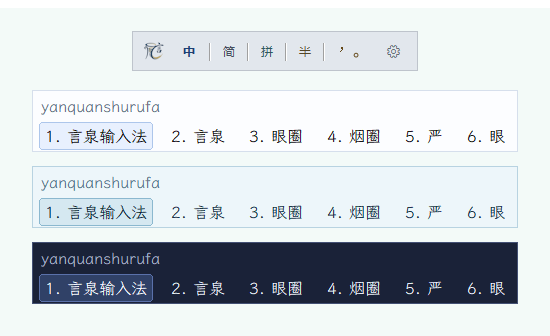

# Cassotis IME

<p align="center">
  
</p>

<p align="center">
  <a href="https://www.yanquan.org">
    <picture>
      <source media="(prefers-color-scheme: dark)" srcset="readme_slogan_dark.svg">
      
    </picture>
  </a>
</p>

<p align="center">
  <a href="https://www.yanquan.org"></a>
  <a href="https://github.com/shenmin/cassotis-ime/releases/latest"></a>
  <a href="LICENSE"></a>
</p>
<p align="center">
  
</p>

**[Website: www.yanquan.org](https://www.yanquan.org)** | English | [简体中文](README.zh-Hans.md) | [繁體中文](README.zh-Hant.md) | [Linux version](https://github.com/shenmin/cassotis-ime-linux) | [macOS version](https://github.com/shenmin/cassotis-ime-mac)

Cassotis IME (言泉输入法) is an open-source Chinese Pinyin input method for Windows 10/11, built primarily in Delphi on top of TSF (Text Services Framework). Candidate ranking, homophone correction, and completion run entirely on the local CPU, centered on a character-level language model trained by the project. There are no ads, bundled programs, or cloud telemetry—dictionaries, settings, and user-learning data remain strictly on the local machine.

Core design goals:
- maintain a reliable native TSF text service architecture,
- keep clear process boundaries (in-process TSF DLL + external host process + offline toolchain),
- unify long-sentence decoding, short-word disambiguation, and completions around one local language model and lightweight corpus-trained rankers.

## Name Origin
The English name **Cassotis** comes from the sacred spring inside the Temple of Apollo at Delphi. In Greek tradition, the priestess Pythia drank from this spring before delivering oracles; because the input method's core is written in Delphi, the name carries a natural connection between origin and tool.

The Chinese name **言泉** (Yanquan, "Spring of Words") echoes Cassotis while drawing on the idiom **言如泉涌** ("words flowing like a spring"), expressing the goal of fluent, unobtrusive text input.

## Features
- **TSF text service:** Implements registration, activation, and the composition lifecycle, including the TSF COM-less capability category for applications that activate text services without COM. Both Win64 and Win32 TSF DLLs (`svr.dll` / `svr32.dll`) are provided, backed by a 64-bit host process.
- **Candidate window:** Supports paging, selection, and partial commitment, with an optional expanded view showing up to three candidate rows while paging (number keys select from the active row; the bottom completion area stays fixed) or a vertical list with one candidate per line. By default, the window aligns with the start of the composition rather than chasing the caret (configurable under Appearance). An optional pair of keys (`;` `'`, or another pair paging leaves free) selects the second and third candidates during composition while remaining ordinary punctuation otherwise. Right-clicking the candidate window opens the tray menu without interrupting active input.
- **Character-from-word selection (以词定字):** When enabled in Keys settings, a pair of keys (`[` and `]`, or another pair left free) commits the first or the last character of the highlighted candidate during Pinyin input; outside composition both keys output normal punctuation, and characters committed this way are not recorded as single-character learning. Off by default. Paging, the second and third candidate keys and this share the pairs `-` `=`, `[` `]`, `,` `.` and `;` `'`, in that order of priority: a pair taken above is not offered below.
- **English recognition:** In full-Pinyin half-width Chinese mode, English words and names (such as `pro`, `markdown`, `Effie`), capitalized tokens, and previously committed letter strings can appear ahead of numbered Chinese candidates. Inputs without a whole-word Chinese reading are selected by default so Space commits them verbatim; ambiguous inputs (such as `bug` or `mac`) are weighed against Chinese readings by the language model using left context. Enabled by default and configurable under General settings (Double Pinyin continues to decode as Chinese).
- **Caret mode indicator:** Switching between Chinese and English, switching into Cassotis from another IME, or focusing an input field while in English mode briefly displays a small non-activating `中` / `英` badge above the caret. Dismissed on the next keystroke, suppressed in password fields, and optional under Appearance settings.
- **One-key completion** (original to Cassotis): Displays at most one high-confidence continuation in the candidate window, accepted with the configured completion key. User entries, exact base-dictionary matches, and vetted transition completions appear immediately, followed by an asynchronous language-model rerank using preceding text. In long sentences it completes the current word or proposes the next phrase, and stays hidden when confidence is low.
- **Custom phrases:** Bind letter shortcuts to frequently used phrases or multi-line templates under Settings > Custom Phrases. Typing the full shortcut surfaces the phrase in the completion area, and the completion key commits it verbatim (preserving line breaks) without altering numbered candidates or Space behavior. Supports reordering and JSON import/export.
- **Long-sentence decoding and correction:** Lexicon-constrained path search constructs full-sentence candidates (for example `womenjintian` → `我们今天`) alongside prefix candidates for step-by-step commitment. The language model selects among complete candidates and corrects localized homophone character or word errors against the typed syllables and left context.
- **Short-word and single-character disambiguation:** Competing exact candidates are resolved by the language model using preceding text when available, combined with general-corpus and conversational word frequencies when no context is present. Single-syllable character candidates are likewise ordered by the language model after left context.
- **Out-of-vocabulary phrases:** Three- to five-syllable inputs not present in the dictionary (such as `jiuguize` → `旧规则`) are assembled from dictionary words, scored as clauses by the language model with left context, and checked for homophone errors; up to two close alternatives may follow the top phrase.
- **Pinyin and Double Pinyin schemes:** Full Pinyin, initial-letter abbreviations, and seven Double Pinyin layouts (Microsoft, Xiaohe, Ziranma, Sogou, Ziguang, Pinyin Jiajia, and Zhineng ABC) share the same ranking pipeline and user-learning database, with 11 independently configurable fuzzy-Pinyin pairs. In Zhineng ABC, `略`/`虐` map to `lm`/`nm` and `绿`/`女` to `lv`/`nv` (matching Rime and Fcitx, without overloading `v` for `üe` so each key pair maps to a distinct syllable).
- **Wubi mixed input (Wubi 86):** An optional scheme types Wubi 86 codes and Full Pinyin in one mode, with no key to switch between them, on SUN Haifeng's Wubi 86 table (about 21,000 characters with their short codes, and 65,000 words). The code table is a file of its own that only this scheme loads; the Pinyin dictionaries and the other schemes are unchanged. Letters that cannot be Pinyin show the code's entries, followed by the first entry of each code one key longer with that key; a unique four-key code commits at once, and a fifth key commits the code's first entry and starts the next code. Letters that also read as Pinyin show the code's common characters and words before Pinyin's candidates and its other entries after Pinyin's first candidate, and an empty code of initials alone shows the Pinyin abbreviation first. After left context the language model brings the entry that fits it to the front of a duplicate code (the others keep the table's order; can be turned off), the completion key finishes a word from its first two or three keys, and the first Pinyin candidate shows the Wubi code that types it. Simplified Chinese only.
- **Dictionaries and frequency import:** Separate simplified and traditional base databases alongside a per-user database. Exported word-frequency lists from other input methods (CSV/TSV lines of word, Pinyin, and count) can be imported under Settings > Advanced, where the learned words can also be searched, deleted, and exported in the same format to carry them to another computer or a fresh install. The traditional dictionary uses standard Taiwan character forms, keeping candidates, completions, and committed text traditional end-to-end while sharing the same language model.
- **Quick input:** `ufh` for symbols, `uxh` for numbered markers, `usx` for math symbols, `urq` / `usj` for current date and time, and `i123.45` / `v123.45` for Chinese numerals and formal currency amounts (use Shift+U/I/V in Double Pinyin). See the [quick-input guide (Chinese)](QUICK_INPUT.md).
- **Chinese punctuation:** Customize symbols kept half-width in Chinese punctuation mode, or switch with one click between the default Markdown preset (``-#*+_=`~[]<>|@``) and standard Chinese punctuation; `\` outputs the enumeration comma `、`.
- **Application context sync:** Synchronizes surrounding text and modifier/key state with the active application.
- **Offline by design:** Runs entirely on the CPU without network access or a GPU; if the language model is still loading or unavailable, candidate ranking falls back cleanly to dictionary order.

<p align="center">
  
  <br>
  <em>Three-row candidate view, with selection numbers on the active row.</em>
</p>

<p align="center">
  
  <br>
  <em>A text field taking the focus in English mode: the mode label above the caret.</em>
</p>

<p align="center">
  
  <br>
  <em>The Keys page of the settings: keys for paging, the second and third candidate, a character of the word, and one-key completion.</em>
</p>

## Download and Install
- **Download:** Download `cassotis_ime_setup_<version>.exe` from [Releases](https://github.com/shenmin/cassotis-ime/releases). The installer (~330 MB) bundles both the simplified and traditional base dictionaries and the local language model.
- **Requirements:** 64-bit Windows 10 or Windows 11 (administrator rights required for installation). Neither network access nor a GPU is required.
- **Install:** Run the installer, then switch to "Cassotis 言泉拼音输入法" in the Windows input method menu (`Win + Space`). A single installation serves all Windows accounts on the machine: read-only base dictionaries are shared under the program directory, while user dictionaries and settings are stored per account.
- **Upgrade:** Run the new installer directly over an existing installation—no prior uninstall or system reboot is required. Processes still holding the previous TSF DLL are listed so you can close them before or restart them after upgrading; Windows Explorer may restart briefly if needed. Per-account settings and user dictionaries under `%LOCALAPPDATA%\CassotisIme` are preserved, and legacy per-account base-dictionary copies are cleaned up automatically.
- **Uninstall:** Uninstall via Windows Settings > Apps. Program files and base dictionaries are removed, with a prompt asking whether to retain or delete user settings, dictionaries, and logs under `%LOCALAPPDATA%\CassotisIme` (retained by default).

## Architecture
- `src/tsf`: TSF COM in-proc server (text service integration).
- `src/engine`: Pinyin parsing, candidate generation, ranking, and user learning.
- `src/host`: external host process for engine/UI orchestration and language-model inference.
- `src/ui`: candidate window and tray UI.
- `src/common`: config, logging, IPC, sqlite wrapper, shared utilities.
- `tools`: registration, dictionary build/import/diagnostics, helper executables.
- `data`: database schema and the language model (`data/models/char_lm`, stored as numbered parts).
- `out`: scripts for build, registration, rebuild and tests; build outputs land here.
- `installer`: Inno Setup script.
- `third_party`: vendored third-party binaries (SQLite, ONNX Runtime).

## Runtime Files
- `cassotis_ime_svr.dll` / `cassotis_ime_svr32.dll`: Win64 and Win32 TSF in-proc COM servers.
- `cassotis_ime_host.exe`: Win64 host process; it runs the engine and the language model.
- `cassotis_ime_tray_host.exe`: Win64 tray/status host for the tray menu, floating status window, and input-state indicator.
- `cassotis_ime_profile_reg.exe`: TSF profile/category registration utility.
- `cassotis_pinyin_transformer_ort.dll`, the ONNX Runtime DLLs and `char_lm\`: the language-model bridge, its runtime and the model. Only the host process loads them, never the TSF DLL.
- `sqlite3_64.dll`: SQLite runtime.

Without the TSF DLL and the main host process, IME input will not work. Without the tray/status host, the core input path may still run, but the tray menu, floating status window, and state indicator will be unavailable. Without the language-model files, the IME still works and ranks candidates without the language model.

## Build and Run (Quick Start)
Prerequisites:
- Windows 10/11
- Delphi 10.4
- Visual Studio 2022 C++ build tools (x64), for the language-model bridge
- the SQLite and ONNX Runtime binaries are included under `third_party/`

From `out/`:

```powershell
.\rebuild_all.ps1
.\cassotis_ime_profile_reg.exe register_tsf -dll_path .\cassotis_ime_svr.dll
.\rebuild_dict.ps1
```

`rebuild_all.ps1` also builds the language-model bridge and joins the model parts in `data/models/char_lm` into the runtime's `char_lm.onnx`. `rebuild_dict.ps1` expects a checkout of [cassotis-lexicon](https://github.com/shenmin/cassotis-lexicon) beside this repository.

For full build details, see `BUILD.md`.

## Dictionary Workflow
The base dictionaries are built from the generated artifacts of the [cassotis-lexicon](https://github.com/shenmin/cassotis-lexicon) project:
- word lists: `dict_unihan_sc.txt`, `dict_unihan_tc.txt`, `dict_clean_sc.txt`, `dict_clean_tc.txt` (`pinyin<TAB>text<TAB>weight`)
- corpus-trained tables from the same directory: word-transition priors, completion priors, the short-word promotion table, and the word frequencies of general text and of everyday conversation
- runtime databases are rebuilt under `%LOCALAPPDATA%\CassotisIme\data\` (`dict_sc.db`, `dict_tc.db`), together with the initial-letter abbreviation index; a development build reads them there, and the installer packages them as the program's read-only base dictionaries
- the Wubi 86 code table of the Wubi mixed scheme (`wubi86_table.txt`, from the lexicon's `data/generated`) is copied beside them and packaged with them; the engine reads it only in that scheme
- the user dictionary defaults to `%LOCALAPPDATA%\CassotisIme\data\user_dict.db`

Main rebuild entry:

```powershell
.\rebuild_dict.ps1
```

## Models and Ranking

### Core language model
- **Unified architecture:** A character-level autoregressive language model of roughly 150M parameters (11 layers, 1,024 hidden size, 12,017-character vocabulary), trained by the project with the architecture and training code of the author's open-source [nc-GPT](https://github.com/shenmin/nc-gpt). It handles full-sentence scoring and Pinyin-conditioned homophone repair, short-word disambiguation, contextual single-character ordering, out-of-vocabulary phrase composition, English-vs-Pinyin arbitration, one-key completion reranking, and long-sentence Tab continuations.
- **Training corpora:** Pretrained offline on independent general Chinese and fiction corpora, both as a plain language model and conditioned on Pinyin. Since v2.7.0, training continued on the 10% subset of the public LCCC dialogue corpus closest to everyday chat and was averaged equally with the prior checkpoint, improving conversational phrasing while preserving general-text and fiction accuracy. Since v2.9.0, it also learns the sentence- and continuation-level preferences of the open-source [Qwen3.5-9B-Base](https://huggingface.co/Qwen/Qwen3.5-9B-Base) (Apache-2.0) through cross-tokenizer sequence-level distillation; the first four positions of each text stay anchored to the prior model so that everyday words at the start of a sentence are not displaced by formal ones, and the result is averaged equally with the prior checkpoint. The teacher scores only during offline training and is not distributed with the IME. All benchmark corpora are strictly excluded from training.
- **Deterministic inference and caching:** Quantized to 8-bit integers with fixed activation ranges and paired with a custom attention operator, producing bit-identical scores regardless of batching or prior cache state. Typing a sentence key by key yields the exact same candidates as decoding the whole Pinyin string at once, while prefix states and output distributions computed on earlier keystrokes are reused directly.
- **Memory footprint:** About 183 MiB in the external host process.

### Policies and statistical priors
- **Decision policies:** Seven lightweight gradient-boosted decision trees (GBDTs) combine language-model scores with lexical signals for long-sentence selection, long-sentence repair gating, context-free short words, contextual short words and fine-grained tie-breaking, one-key completion, and Tab continuation. They are fit on engine execution traces over held-out corpora and refit whenever the base model updates.
- **Structural rankers:** Three compact rankers guide lattice pruning and initial ordering of the complete-candidate pool during long-sentence search.
- **Lexicon tables:** Statistical tables imported from `cassotis-lexicon` provide word-transition priors, completion popularity priors, a precomputed short-word promotion table, and word frequencies from both general text and everyday conversation.

### Ranking by input path
- **Long sentences:** Lexicon-constrained search builds candidate paths; two structural rankers govern pruning and a third orders complete candidates. The language model scores top candidates for the long-sentence policy, then checks the winning sentence against the typed syllables and up to 48 characters of left context to repair homophone typos or swap whole homophone words (a decision tree accepts or rejects each rewrite from the correction and language-model scores and the word frequencies before and after the edit, with a second verification pass when edited). Supported across Full Pinyin, Double Pinyin, and both scripts; user words, exact full-query dictionary entries, and fuzzy-Pinyin inputs are left untouched.
- **Short words and single characters:** Exact candidates follow dictionary order unless contextual language-model scores justify reordering. Without left context, the policy incorporates general-corpus word frequencies while protecting top words that are much more common in everyday conversation (`zhezhou` → 这周); pure dictionary ties use the precomputed short-word promotion table. Single-syllable characters are ranked by the language model when left context is present and by modern character frequency otherwise.
- **Out-of-vocabulary phrases:** Three- to five-syllable inputs absent from both base and user dictionaries are segmented into candidate drafts from dictionary entries, scored as standalone clauses by the language model (using left context when available), and checked for homophone repairs. Supported in Double Pinyin and traditional mode; disabled when fuzzy Pinyin is active or `'` separators are present. Non-top phrases chosen by the user are saved to the user dictionary.
- **One-key completion:** Base-dictionary and strong-transition completions appear immediately while the language model asynchronously reranks a broader candidate set in the background, updating the prompt only on a clear margin; previously skipped suggestions are suppressed.
- **Long-sentence Tab continuation:** The language model proposes subsequent characters and evaluates word completions and next-phrase extensions, with the Tab policy selecting a single continuation or abstaining.

### Runtime characteristics
- Runs 100% locally on the CPU without network calls or GPU dependencies.
- ONNX Runtime and the model reside exclusively in the external host process, never inside the in-process TSF DLL; while loading or if unavailable, ranking degrades gracefully to dictionary order.
- Each language-model call enforces a latency budget (100 ms by default), dropping late results without blocking input.
- Inference uses one thread per physical core (clamped between 4 and 8 threads).
- Full-sentence batch decoding averages roughly 81 ms, whereas interactive key-by-key typing reuses cached states and responds within a few milliseconds to a few tens of milliseconds.
- Statistical tables live in local SQLite databases; compact rankers and GBDT parameters are compiled directly into deterministic native Pascal code.
- Long-sentence and short-word pipelines remain separate so changes in one do not disturb exact-match behavior in the other.

## Long Sentence Benchmark-16300
See [BENCHMARK.md](BENCHMARK.md) for the Benchmark-16300 methodology, corpus source, and scoring rules.

Corpus: 16,300 eligible Chinese sentences from the developer's own novel [**Elegance in Timelessness**](https://www.qidian.com/book/1037259117/) (Chinese title: [**永恒的舞动**](https://www.qidian.com/book/1037259117/)).

| Version | Top1 | Top2 | Mean (ms) | P50 (ms) | P95 (ms) | Max (ms) |
|---|---:|---:|---:|---:|---:|---:|
| `v2.9.0` | 13869/16300 (85.09%) | 14789/16300 (90.73%) | 81.16 | 78 | 141 | 453 |
| `v2.8.0` | 13750/16300 (84.36%) | 14695/16300 (90.15%) | 80.67 | 78 | 141 | 422 |
| `v2.7.0` | 13739/16300 (84.29%) | 14685/16300 (90.09%) | 81.99 | 78 | 141 | 422 |
| `v2.6.0` | 13740/16300 (84.29%) | 14686/16300 (90.10%) | 83.07 | 78 | 141 | 422 |
| `v2.5.0` | 13442/16300 (82.47%) | 14358/16300 (88.09%) | 72.73 | 78 | 110 | 359 |
| `v2.4.0` | 13435/16300 (82.42%) | 14314/16300 (87.82%) | 71.84 | 63 | 110 | 344 |
| `v2.3.0` | 13429/16300 (82.39%) | 14310/16300 (87.79%) | 73.35 | 78 | 125 | 344 |
| `v2.2.0` | 13390/16300 (82.15%)<br>*13397/16300 (82.19%)* | 14273/16300 (87.56%)<br>*14281/16300 (87.61%)* | 73.26<br>*72.10* | 78 | 125<br>*110* | 344<br>*328* |
| `v2.1.0` | 13381/16300 (82.09%) | 14270/16300 (87.55%) | 75.28 | 78 | 125 | 343 |
| `v2.0.0` | 13380/16300 (82.09%) | 14268/16300 (87.53%) | 74.79 | 78 | 125 | 344 |
| `v1.31.0` | 12940/16300 (79.39%) | 13534/16300 (83.03%) | 61.29 | 62 | 94 | 282 |
| `v1.30.0` | 12828/16300 (78.70%) | 13514/16300 (82.91%) | 55.25 | 47 | 94 | 266 |
| `v1.29.0` | 11997/16300 (73.60%) | 12970/16300 (79.57%) | 39.89 | 32 | 63 | 234 |
| `v1.28.0` | 11987/16300 (73.54%) | 12964/16300 (79.53%) | 63.72 | 62 | 109 | 484 |
| `v1.27.0` | 11978/16300 (73.48%) | 12955/16300 (79.48%) | 63.08 | 62 | 109 | 468 |
| `v1.26.0` | 11974/16300 (73.46%) | 12947/16300 (79.43%) | 62.83 | 62 | 109 | 453 |
| `v1.25.0` | 11698/16300 (71.77%) | 12830/16300 (78.71%) | 57.49 | 47 | 94 | 438 |
| `v1.24.0`<br/>`v1.23.0` | 11679/16300 (71.65%) | 12813/16300 (78.61%) | 57.09 | 47 | 94 | 438 |
| `v1.22.0` | 11672/16300 (71.61%) | 12809/16300 (78.58%) | 55.17 | 47 | 94 | 407 |
| `v1.21.1` | 11080/16300 (67.98%) | 12395/16300 (76.04%) | 59.33 | 62 | 109 | 407 |
| `v1.20.0` | 11065/16300 (67.88%) | 12376/16300 (75.93%) | 59.53 | 47 | 110 | 406 |
| `v1.19.0` | 10917/16300 (66.98%) | 12248/16300 (75.14%) | 55.99 | 47 | 94 | 437 |
| `v1.18.0` | 10731/16300 (65.83%) | 12128/16300 (74.40%) | 51.78 | 47 | 93 | 454 |
| `v1.17.0` | 10595/16300 (65.00%) | 12023/16300 (73.76%) | 42.68 | 32 | 78 | 406 |
| `v1.16.0` / `v1.15.0` | 10553/16300 (64.74%) | 11921/16300 (73.13%) | 41.5 | 32 | 78 | 484 |
| `v1.14.0` | 10345/16300 (63.47%) | 11903/16300 (73.02%) | 58.78 | 47 | 172 | 766 |
| `v1.13.0` | 10131/16300 (62.15%) | 11320/16300 (69.45%) | 65.94 | 47 | 203 | 1047 |
| `v1.12.0` | 9767/16300 (59.92%) | 10996/16300 (67.46%) | 63.03 | 47 | 187 | 1062 |
| `v1.11.0` | 9760/16300 (59.88%)<br>*9340/16300 (57.30%)* | 10990/16300 (67.42%)<br>*10773/16300 (66.09%)* | 59.82 | 47 | 187 | 1031 |
| `v1.10.0` | 9279/16300 (56.93%) | 10708/16300 (65.69%) | 60.39 | 47 | 188 | 1046 |
| `v1.9.0` | 9121/16300 (55.96%) | 10685/16300 (65.55%) | 59.65 | 47 | 187 | 1172 |
| `v1.8.1` | 8285/16300 (50.83%) | 9067/16300 (55.63%) | 72.44 | 47 | 281 | 1594 |
| `v1.7.0` | 7940/16300 (48.71%) | 8642/16300 (53.02%) | 71.55 | 47 | 235 | 2047 |
| `v1.6.0` | 7936/16300 (48.69%) | 8637/16300 (52.99%) | 66.99 | 32 | 219 | 1687 |
| `v1.5.0` | 7459/16300 (45.76%) | 7966/16300 (48.87%) | 63.42 | 46 | 203 | 2140 |
| `v1.4.0` | 7168/16300 (43.98%) | 7617/16300 (46.73%) | 66.23 | 46 | 218 | 2578 |
| `v1.3.0` | 7155/16300 (43.90%) | 7601/16300 (46.63%) | 64.54 | 46 | 203 | 2188 |
| `v1.2.0` | 6895/16300 (42.30%) | 7303/16300 (44.80%) | 59.89 | 32 | 188 | 2078 |
| `v1.1.0` | 6677/16300 (40.96%) | 7067/16300 (43.36%) | 73.18 | 47 | 234 | 2750 |
| `v1.0.0` | 6106/16300 (37.46%) | 6857/16300 (42.07%) | 71.49 | 47 | 219 | 5344 |
| `v0.8.5` | 6097/16300 (37.40%) | 6847/16300 (42.01%) | 520.05 | 406 | 1203 | 13297 |
| `v0.7.0` | 5368/16300 (32.93%) | 6110/16300 (37.48%) | — | — | — | — |
| `v0.6.0` | 4905/16300 (30.09%) | 5378/16300 (32.99%) | — | — | — | — |
| `v0.5.0` | 4834/16300 (29.66%) | 5243/16300 (32.17%) | — | — | — | — |
| `v0.4.0` | 4371/16300 (26.82%) | 4744/16300 (29.10%) | — | — | — | — |
| `v0.3.1` | 3845/16300 (23.59%) | 4651/16300 (28.53%) | — | — | — | — |
| `v0.2.0` | 2671/16300 (16.39%) | 2863/16300 (17.56%) | — | — | — | — |

From `v2.3.0`, results use the cases of the second reading correction (see [BENCHMARK.md](BENCHMARK.md)). For `v2.2.0`, regular values were re-measured on the corrected cases with the `v2.2.0` runtime and benchmark dictionary and compare with later releases; italic values are those published with `v2.2.0` and compare with earlier releases. A column with one value is the same in both.

`v1.12.0` uses the new scoring rule that treats `他` and `她` as equivalent at the same character positions. For `v1.11.0`, regular values use this rule, while italic values use the previous strict rule that distinguishes them. `v1.10.0` and earlier releases use the strict rule; releases from `v1.12.0` onward publish only the new-rule results.

Latency values are engine-only full-query decode times. Each complete Pinyin query is assigned at once, so these values do not represent incremental keystroke-to-display latency. `—` means that the version was not measured under this latency protocol. See [BENCHMARK.md](BENCHMARK.md) for the complete methodology.

## Short-word Context Benchmark-65000
This benchmark contains 65,000 occurrences of two- to four-character words, each paired with the sentence prefix already committed before that word. Its cases use the same novel text as Benchmark-16300 as their source and are excluded from short-context model training. User-dictionary ranking is disabled during evaluation.

See [BENCHMARK.md](BENCHMARK.md) for the shared corpus source, short-word case construction, scoring rules, and latency protocol.

`Contested` is the subset where the same Pinyin query maps to at least two expected words in the corpus, making left context materially useful. The table reports the context-enabled benchmark.

| Version | Top1 | Top2 | Contested Top1 | Contested Top2 | Mean (ms) | P50 (ms) | P95 (ms) | Max (ms) |
|---|---:|---:|---:|---:|---:|---:|---:|---:|
| `v2.9.0` | 63500/65000 (97.69%) | 64563/65000 (99.33%) | 10534/11685 (90.15%) | 11313/11685 (96.82%) | 4.793 | 2.506 | 12.263 | 31.885 |
| `v2.8.0` | 63502/65000 (97.70%) | 64565/65000 (99.33%) | 10546/11685 (90.25%) | 11315/11685 (96.83%) | 4.754 | 2.447 | 12.404 | 30.502 |
| `v2.7.0` | 63502/65000 (97.70%) | 64564/65000 (99.33%) | 10545/11685 (90.24%) | 11315/11685 (96.83%) | 4.771 | 2.453 | 12.518 | 39.229 |
| `v2.6.0` | 63454/65000 (97.62%) | 64518/65000 (99.26%) | 10514/11685 (89.98%) | 11280/11685 (96.53%) | 4.822 | 2.492 | 12.904 | 47.310 |
| `v2.5.0` | 63463/65000 (97.64%) | 64436/65000 (99.13%) | 10512/11685 (89.96%) | 11223/11685 (96.05%) | 4.776 | 2.416 | 12.623 | 37.362 |
| `v2.4.0` | 63455/65000 (97.62%) | 64423/65000 (99.11%) | 10539/11685 (90.19%) | 11225/11685 (96.06%) | 4.599 | 2.297 | 12.579 | 32.917 |
| `v2.3.0` | 63421/65000 (97.57%) | 64427/65000 (99.12%) | 10504/11685 (89.89%) | 11228/11685 (96.09%) | 4.611 | 2.267 | 12.545 | 33.331 |
| `v2.2.0` | 63350/65000 (97.46%)<br>*63364/65000 (97.48%)* | 64347/65000 (99.00%)<br>*64292/65000 (98.91%)* | 10504/11685 (89.89%)<br>*10533/11728 (89.81%)* | 11228/11685 (96.09%)<br>*11244/11728 (95.87%)* | 4.710<br>*4.509* | 2.362<br>*2.201* | 12.952<br>*12.289* | 42.544<br>*41.085* |
| `v2.1.0`<br/>`v2.0.0` | 63363/65000 (97.48%) | 64291/65000 (98.91%) | 10533/11728 (89.81%) | 11244/11728 (95.87%) | 4.637 | 2.205 | 12.621 | 40.883 |
| `v1.31.0` | 63036/65000 (96.98%) | 64104/65000 (98.62%) | 10491/11728 (89.45%) | 11196/11728 (95.46%) | 4.582 | 3.262 | 10.352 | 22.327 |
| `v1.30.0` | 62926/65000 (96.81%) | 64073/65000 (98.57%) | 10449/11728 (89.09%) | 11169/11728 (95.23%) | 3.525 | 3.192 | 7.660 | 21.122 |
| `v1.29.0` | 61971/65000 (95.34%) | 63568/65000 (97.80%) | 9675/11728 (82.49%) | 10776/11728 (91.88%) | 2.999 | 2.198 | 7.316 | 27.596 |
| `v1.28.0` | 61860/65000 (95.17%) | 63562/65000 (97.79%) | 9596/11728 (81.82%) | 10775/11728 (91.87%) | 4.453 | 3.908 | 9.214 | 34.468 |
| `v1.27.0`<br/>`v1.26.0` | 61860/65000 (95.17%) | 63549/65000 (97.77%) | 9596/11728 (81.82%) | 10775/11728 (91.87%) | 4.474 | 3.908 | 9.310 | 35.645 |
| `v1.25.0` | 61859/65000 (95.17%) | 63549/65000 (97.77%) | 9596/11728 (81.82%) | 10775/11728 (91.87%) | 4.705 | 4.103 | 9.817 | 40.027 |
| `v1.18.0` - `v1.24.0` | 61827/65000 (95.12%) | 63517/65000 (97.72%) | 9596/11728 (81.82%) | 10775/11728 (91.87%) | 4.584 | 3.985 | 9.653 | 39.36 |
| `v1.15.0` - `v1.17.0` | 61827/65000 (95.12%) | 63516/65000 (97.72%) | 9596/11728 (81.82%) | 10775/11728 (91.87%) | 3.817 | 3.239 | 8.376 | 39.881 |
| `v1.14.0` | 61782/65000 (95.05%) | 63516/65000 (97.72%) | 9560/11728 (81.51%) | 10775/11728 (91.87%) | 3.998 | 3.132 | 8.665 | 68.147 |
| `v1.13.0` | 61515/65000 (94.64%) | 63516/65000 (97.72%) | 9384/11728 (80.01%) | 10775/11728 (91.87%) | 4.748 | 3.652 | 10.337 | 103.689 |
| `v1.12.0` | 61343/65000 (94.37%) | 63474/65000 (97.65%) | 9304/11728 (79.33%) | 10745/11728 (91.62%) | 4.400 | 3.417 | 9.462 | 104.316 |
| `v1.11.0` | 61343/65000 (94.37%)<br>*61227/65000 (94.20%)* | 63474/65000 (97.65%)<br>*63461/65000 (97.63%)* | 9304/11728 (79.33%)<br>*9191/11728 (78.37%)* | 10745/11728 (91.62%)<br>*10732/11728 (91.51%)* | 4.217 | 3.284 | 9.110 | 75.503 |
| `v1.10.0` | 61214/65000 (94.18%) | 63448/65000 (97.61%) | 9191/11728 (78.37%) | 10732/11728 (91.51%) | 4.425 | 3.446 | 9.591 | 84.68 |
| `v1.9.0` | 61215/65000 (94.18%) | 63448/65000 (97.61%) | 9191/11728 (78.37%) | 10732/11728 (91.51%) | 4.214 | 3.268 | 9.113 | 71.004 |
| `v1.8.1` | 61206/65000 (94.16%) | 63430/65000 (97.58%) | 9182/11728 (78.29%) | 10725/11728 (91.45%) | 4.85 | 3.721 | 10.413 | 107.714 |
| `v1.7.0` | 61053/65000 (93.93%) | 63424/65000 (97.58%) | 9154/11728 (78.05%) | 10723/11728 (91.43%) | 4.668 | 3.468 | 10.013 | 158.471 |
| `v1.6.0` | 61043/65000 (93.91%) | 63414/65000 (97.56%) | 9154/11728 (78.05%) | 10723/11728 (91.43%) | 4.455 | 3.295 | 9.580 | 160.817 |
| `v1.5.0` | 61045/65000 (93.92%) | 63364/65000 (97.48%) | 9159/11728 (78.10%) | 10677/11728 (91.04%) | 5.033 | 4.113 | 9.968 | 142.372 |
| `v1.4.0` | 60676/65000 (93.35%) | 63251/65000 (97.31%) | 8993/11728 (76.68%) | 10602/11728 (90.40%) | 5.573 | 4.521 | 11.157 | 158.687 |
| `v1.3.0` | 59078/65000 (90.89%) | 62881/65000 (96.74%) | 8326/11728 (70.99%) | 10386/11728 (88.56%) | 5.460 | 4.396 | 10.939 | 176.912 |

From `v2.3.0`, results use the cases of the second reading correction (see [BENCHMARK.md](BENCHMARK.md)), and `Contested` is recomputed from them: 11,685 cases, 11,728 before. For `v2.2.0`, regular values were re-measured on the corrected cases with the `v2.2.0` runtime and benchmark dictionary and compare with later releases; italic values are those published with `v2.2.0` and compare with earlier releases. A column with one value is the same in both.

`v1.12.0` uses the new scoring rule that treats `他` and `她` as equivalent at the same character positions. For `v1.11.0`, regular values use this rule, while italic values use the previous strict rule that distinguishes them. `v1.10.0` and earlier releases use the strict rule; releases from `v1.12.0` onward publish only the new-rule results.

Latency values are engine-only per-query times for the context-enabled track and do not include TSF or candidate-window rendering.

## One-key Completion Context Benchmark-12831
This benchmark reuses the frozen short-word context corpus and expands eligible targets into 12,831 incremental Pinyin-prefix opportunities. It evaluates the single completion actually shown when left context is enabled.

Public results retain five columns: `Completion Hit`, `Avg Keys Saved`, `Stability`, `Keystroke P95 (ms)`, and `Final P95 (ms)`; the two latencies differ only from `v1.31.0`, when an asynchronous language-model rerank was added. Results are recorded from `v1.15.0`; see [BENCHMARK.md](BENCHMARK.md) for case construction, scoring, and latency details.

| Version | Completion Hit | Avg Keys Saved | Stability | Keystroke P95 (ms) | Final P95 (ms) |
| --- | --- | --- | --- | --- | --- |
| `v2.9.0` | 10561/12831 (82.31%) | 2.642 | 2178/2234 (97.49%) | 1.604 | 18.805 |
| `v2.8.0` | 10506/12831 (81.88%) | 2.634 | 2141/2202 (97.23%) | 1.641 | 18.370 |
| `v2.7.0` | 10506/12831 (81.88%) | 2.635 | 2141/2202 (97.23%) | 1.680 | 18.933 |
| `v2.6.0`<br/>`v2.5.0` | 10512/12831 (81.93%) | 2.635 | 2151/2214 (97.15%) | 1.693 | 19.469 |
| `v2.4.0` | 10512/12831 (81.93%) | 2.636 | 2152/2215 (97.16%) | 1.620 | 19.917 |
| `v2.3.0` | 10512/12831 (81.93%) | 2.635 | 2151/2214 (97.15%) | 1.559 | 19.515 |
| `v2.2.0` | 10465/12831 (81.56%)<br>*10456/12831 (81.49%)* | 2.632 | 2132/2196 (97.09%)<br>*2131/2193 (97.17%)* | 1.549<br>*1.508* | 19.976<br>*19.728* |
| `v2.1.0`<br/>`v2.0.0` | 10440/12831 (81.37%) | 2.633 | 2124/2186 (97.16%) | 1.521 | 20.445 |
| `v1.31.0` | 10336/12831 (80.55%) | 2.638 | 2123/2185 (97.16%) | 1.238 | 11.881 |
| `v1.30.0`<br/>`v1.29.0` | 9420/12831 (73.42%) | 2.548 | 1691/1749 (96.68%) | 0.968 | 0.968 |
| `v1.18.0` - `v1.28.0` | 9419/12831 (73.41%) | 2.549 | 1691/1749 (96.68%) | 2.026 | 2.026 |
| `v1.17.0` | 9273/12831 (72.27%) | 2.554 | 1652/1718 (96.16%) | 1.880 | 1.880 |
| `v1.16.0` | 8752/12831 (68.21%) | 2.570 | 1649/1676 (98.39%) | 1.509 | 1.509 |
| `v1.15.0` | 7265/12831 (56.62%) | 2.542 | 1278/1323 (96.60%) | 0.777 | 0.777 |

From `v2.3.0`, results use the short-word cases of the second reading correction (see [BENCHMARK.md](BENCHMARK.md)). For `v2.2.0`, regular values were re-measured on the corrected cases with the `v2.2.0` runtime and benchmark dictionary and compare with later releases; italic values are those published with `v2.2.0` and compare with earlier releases. A column with one value is the same in both.

## Long-sentence One-key Completion Benchmark-16300
This benchmark leaves the final four complete Pinyin syllables untyped and evaluates the single completion actually shown. A hit must correctly extend the intended prefix while remaining a prefix of the reference sentence; it need not complete the entire sentence in one step. See [BENCHMARK.md](BENCHMARK.md) for the full protocol.

### Current local-continuation protocol

| Version | Local Completion Hit | Predictive Prompt Coverage | Total Keys Saved | P95 (ms) |
| --- | --- | --- | --- | --- |
| `v2.9.0` | 4012/16300 (24.61%) | 16217/16300 (99.49%) | 9836 | 147.564 |
| `v2.8.0` | 3974/16300 (24.38%) | 16231/16300 (99.58%) | 9804 | 145.366 |
| `v2.7.0` | 3979/16300 (24.41%) | 16232/16300 (99.58%) | 9814 | 147.046 |
| `v2.6.0` | 3949/16300 (24.23%) | 16155/16300 (99.11%) | 9695 | 144.409 |
| `v2.5.0` | 3896/16300 (23.90%) | 16152/16300 (99.09%) | 9592 | 128.253 |
| `v2.4.0` | 3876/16300 (23.78%) | 16147/16300 (99.06%) | 9576 | 129.597 |
| `v2.3.0` | 3870/16300 (23.74%) | 16148/16300 (99.07%) | 9548 | 135.342 |
| `v2.2.0` | 3769/16300 (23.12%)<br>*3766/16300 (23.10%)* | 16122/16300 (98.91%)<br>*16121/16300 (98.90%)* | 9279<br>*9271* | 133.142<br>*128.998* |
| `v2.1.0` | 3758/16300 (23.06%) | 16123/16300 (98.91%) | 9272 | 141.519 |
| `v2.0.0` | 3755/16300 (23.04%) | 16123/16300 (98.91%) | 9265 | 133.001 |
| `v1.31.0` | 3513/16300 (21.55%) | 15815/16300 (97.02%) | 7478 | 116.682 |
| `v1.30.0` | 855/16300 (5.25%) | 7203/16300 (44.19%) | 1822 | 77.819 |
| `v1.29.0` | 449/16300 (2.75%)<br>*424/16300 (2.60%)* | 6778/16300 (41.58%) | 1023<br>*987* | 53.085 |
| `v1.28.0` | 426/16300 (2.61%) | 6776/16300 (41.57%) | 989 | 78.689 |
| `v1.27.0` | 425/16300 (2.61%) | 6769/16300 (41.53%) | 987 | 80.099 |
| `v1.26.0` | 410/16300 (2.52%) | 6488/16300 (39.80%) | 967 | 80.437 |
| `v1.25.0` | 409/16300 (2.51%) | 6489/16300 (39.81%) | 959 | 74.936 |
| `v1.22.0` - `v1.24.0` | 407/16300 (2.50%) | 6474/16300 (39.72%) | 953 | 77.103 |
| `v1.21.1`<br/>`v1.20.0` | 357/16300 (2.19%) | 6475/16300 (39.72%) | 861 | 118.064 |
| `v1.19.0` | 202/16300 (1.24%) | 3834/16300 (23.52%) | 571 | 92.453 |
| `v1.18.0` | 143/16300 (0.88%) | 3957/16300 (24.28%) | 478 | 109.060 |

From `v2.3.0`, results use the long-sentence cases of the second reading correction (see [BENCHMARK.md](BENCHMARK.md)). For `v2.2.0`, regular values were re-measured on the corrected cases with the `v2.2.0` runtime and benchmark dictionary and compare with later releases; italic values are those published with `v2.2.0` and compare with earlier releases. A column with one value is the same in both.

From `v1.30.0`, this benchmark treats `他` and `她` as equivalent at the same character positions. For `v1.29.0`, regular values are rescored from the saved results using this rule, while italic values retain the previous strict rule. Predictive prompt coverage and latency are unchanged. `v1.28.0` and earlier releases use the strict rule; releases from `v1.30.0` onward publish only the new-rule results.

`Predictive Prompt Coverage` counts opportunities where a predictive completion was displayed; exact-word joins that only convert already typed Pinyin are excluded. `Total Keys Saved` sums the net keys saved by correct local-continuation hits after charging one key for accepting each completion. Per-hit averages and incremental stability remain available in detailed diagnostic reports rather than the public comparison table.

### Historical whole-sentence protocol

| Version | Whole-sentence Hit | Total Keys Saved | P95 (ms) |
| --- | --- | --- | --- |
| `v1.17.0` | 20/16300 (0.12%) | 124 | 55.049 |
| `v1.16.0` | 10/16300 (0.06%) | 71 | 65.063 |

`v1.16.0` and `v1.17.0` use the legacy strict whole-sentence criterion and are retained only as historical results. They are not directly comparable with the current local-continuation protocol.

## Configuration
Default config file:
- `%LOCALAPPDATA%\CassotisIme\cassotis_ime.ini`

Important options include:
- Input scheme (Full Pinyin / Microsoft Double Pinyin / Xiaohe Double Pinyin / Ziranma Double Pinyin / Sogou Double Pinyin / Ziguang Double Pinyin / Pinyin Jiajia / Zhineng ABC Double Pinyin / Wubi mixed input: `wubi_mixed` in `[engine]`, with `wubi_context_order` for the contextual order of duplicate codes)
- simplified/traditional variant switching (`variant`)
- full-width / punctuation mode
- whether a full stop typed after consecutive digits becomes a decimal point (`decimal_period_after_digit`)
- symbols kept half-width in Chinese punctuation (`ascii_symbols` in `[punctuation]`, the Markdown preset by default)
- English recognition in Chinese mode (`auto_english` in `[input]`, on by default)
- the candidate window at the start of the input (`candidate_at_input_start`, on by default)
- a vertical candidate list (`candidate_vertical`, off by default)
- a pair of keys for the second and third candidate (`second_third_candidate_keys`, off by default)
- a pair of keys for the first and last character of the candidate (`select_character_keys`, off by default); paging and these two share the pairs `-` `=`, `[` `]`, `,` `.` and `;` `'`, paging choosing first
- the mode label beside the caret (`input_mode_hint`, on by default)
- debug logging and log path

An installed version reads its base dictionaries from its program folder (`<install folder>\runtime\<version folder>\base_dict\`), read-only and shared by all Windows accounts; a development build reads them from `%LOCALAPPDATA%\CassotisIme\data\`. The user dictionary is `%LOCALAPPDATA%\CassotisIme\data\user_dict.db` in each account. These paths are not configured through the INI file.

## Documentation
- Simplified Chinese documentation: [README.zh-Hans.md](README.zh-Hans.md)
- Traditional Chinese documentation: [README.zh-Hant.md](README.zh-Hant.md)
- Benchmark methodology: [BENCHMARK.md](BENCHMARK.md)
- Configuration reference: `CONFIGURE.md`
- Quick input guide (Chinese): [QUICK_INPUT.md](QUICK_INPUT.md)
- Website: [www.yanquan.org](https://www.yanquan.org)
- Build details: `BUILD.md`
- Third-party notices: `THIRD_PARTY.md`

## Roadmap
- continue improving the core language model (training data coverage, capacity, and quantization) across all ranking paths
- progressively consolidate auxiliary rankers, policies, and statistical tables where the language model can handle decisions directly
- extend language-model homophone repair and out-of-vocabulary phrase composition to fuzzy Pinyin, accompanied by a public benchmark
- further reduce keystroke-to-display latency, particularly on long sentences
- expand held-out evaluation suites and error-attribution tooling
- strengthen user-dictionary management and quality controls
- broaden application compatibility testing across editors, browsers, and IDEs

## Version History
Key architectural milestones in candidate ranking and modeling; full per-release changelogs are available on [Releases](https://github.com/shenmin/cassotis-ime/releases).

- **v1.1.0 (Statistical language model):** Introduced an offline-trained local statistical language model (lexicon-constrained word bigrams/trigrams and smoothed character trigrams trained on cleaned general Chinese and fiction text) for long-sentence path ranking. Benchmark corpora have been strictly held out from training since this release.
- **v1.3.0 – v1.15.0 (Multi-stage neural reranking):** Deployed the first compact neural residual reranker trained on lexicon-constrained N-best comparisons (v1.3.0), followed by contextual short-word reranking and residual verification (v1.4.0–v1.5.0), multi-stage lattice pruning and candidate-pool ranking (v1.6.0–v1.9.0), bidirectional character-model features (v1.13.0), and a top-two long-sentence arbiter (v1.15.0).
- **v1.18.0 – v1.26.0 (Constrained generation and homophone repair):** Expanded beyond candidate reranking into constrained text generation and Pinyin-conditioned correction, adding neural continuation fallbacks (v1.18.0), Pinyin-conditioned sequence scoring (v1.19.0), quantized candidate generators (v1.20.0), distilled local homophone correction reading up to ~256 characters of left context (v1.22.0), and joint selection over candidate repairs (v1.26.0).
- **v1.30.0 – v1.31.0 (Shared character language model):** Introduced a self-trained character-level autoregressive language model for full-sentence selection, contextual short-word disambiguation (replacing RBT3), Tab continuation, and asynchronous one-key completion reranking.
- **v2.0.0 (Consolidation to a single language model):** Replaced 11 separate ONNX models and 43 compiled parameter units with a unified pipeline around one ONNX character language model and seven compact ranking/policy units, cutting model memory from ~447 MiB to ~183 MiB and guaranteeing batch-invariant deterministic scores. Three- to five-syllable out-of-vocabulary phrases moved from heuristic joining to model-driven composition and repair, improving accuracy across all four benchmarks at a modest batch-decode latency cost (75 ms vs. 61 ms).
- **v2.1.0 (Mixed English input):** Added inline English word recognition ahead of numbered candidates, using the language model and left context to arbitrate inputs that are valid in both English and Pinyin.
- **v2.3.0 (Traditional Chinese):** Mapped traditional candidates and context through simplified script for language-model scoring while outputting standard Taiwan traditional forms, eliminating low-frequency bias on traditional-only glyphs.
- **v2.5.0 (General-corpus word frequencies):** Incorporated general-corpus training data and word-frequency tables into short-word ranking so everyday standard words lead without context (`shixian` → 实现, `gushi` → 故事), and expanded word transitions from 120M characters of general text.
- **v2.6.0 (Joint repair arbitration and real-context short-word policy):** Combined Pinyin-repair and language-model scores to gate sentence rewrites and whole-word homophone swaps, and trained a dedicated contextual short-word tree on actual clause-to-caret prefixes.
- **v2.7.0 (Conversational adaptation and full-scheme parity):** Continued language-model training on everyday dialogue data and refit all six GBDT policies, lifting key-by-key contextual chat clause accuracy (74.60% → 76.90%) without regressing fiction or general text; extended out-of-vocabulary phrase composition, two-pass sentence repair, and contextual single-character ordering to traditional Chinese and Double Pinyin.
- **v2.8.0 (Short-term learning boost, output-row caching, and character selection):** Added two-hour repeated-choice boosting while removing permanent single-character pinning, introduced `[` / `]` character-from-word selection and a redesigned Settings UI, cached language-model output distributions to cut contextual single-syllable latency, and refined Taiwan traditional single-character ordering.
- **v2.9.0 (Distillation from a larger model and learned repair gating):** Distilled the language model from Qwen3.5-9B-Base through cross-tokenizer sequence-level preference distillation (with sentence starts anchored to the prior model) and refit all seven GBDT policies; a decision tree now gates long-sentence repairs using word-frequency evidence, lifting official long-sentence Top1 from 84.36% to 85.09% and one-key completion hits from 81.88% to 82.31%; added user-dictionary export, management of learned words, and a vertical candidate list.

## License
This project is licensed under GPL-3.0. See `LICENSE` for the full license text.

Keep third-party notices and attribution files consistent with `THIRD_PARTY.md`.
