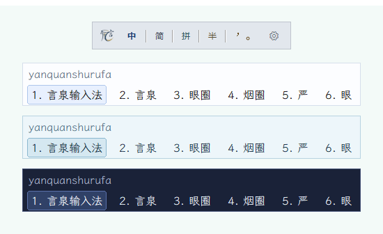

# Cassotis IME（言泉输入法）

<p align="center">
  
</p>

<p align="center">
  <a href="https://www.yanquan.org">
    <picture>
      <source media="(prefers-color-scheme: dark)" srcset="readme_slogan_dark.svg">
      
    </picture>
  </a>
</p>

<p align="center">
  <a href="https://www.yanquan.org"></a>
  <a href="https://github.com/shenmin/cassotis-ime/releases/latest"></a>
  <a href="LICENSE"></a>
</p>
<p align="center">
  
</p>

**[官网 www.yanquan.org](https://www.yanquan.org)** | [English](README.md) | 简体中文 | [繁體中文](README.zh-Hant.md) | [Linux 版](https://github.com/shenmin/cassotis-ime-linux) | [macOS 版](https://github.com/shenmin/cassotis-ime-mac)

Cassotis IME（言泉输入法）是一款面向 Windows 10/11 的开源中文拼音输入法，同时支持五笔混输，基于 Delphi 与 TSF（Text Services Framework）构建。候选排序、同音纠错与联想补全均在本机 CPU 上运行，核心为项目自研的本地字符级语言模型。无广告、不捆绑软件、不上传输入记录，词库、设置与个人学习数据均保存在本地。

核心设计目标：
- 构建稳定可靠的原生 TSF 文本服务架构；
- 保持组件边界清晰（TSF 进程内 DLL + 独立 Host 进程 + 离线工具链）；
- 依托单一本地语言模型与轻量语料统计模型，统一承担长句、短词与补全排序。

## 名称来源
英文名 **Cassotis** 源自古希腊德尔斐（Delphi）神庙内的圣泉。相传女祭司皮媞亚（Pythia）在传达神谕前会饮下此泉水以获灵感；项目核心恰以 Delphi 语言编写，以此为名亦有一层呼应。

中文名 **言泉** 既对应圣泉意象，也取“言如泉涌”之意，期许顺畅自然的中文输入体验。

## 主要特性
- **TSF 文本服务**：完整实现注册、激活与组合输入生命周期，并注册 TSF COM-less 能力类别以兼容对应宿主。TSF 服务同时提供 Win64 与 Win32 版本（`svr.dll` / `svr32.dll`），后台 Host 进程为纯 Win64。
- **候选窗口**：支持翻页、选词与分段上屏；可选横排、横排且翻页时展开多行（最多同屏显示三行，数字键选择当前高亮行，底部补全区位置不变）或竖排（每行一个候选）。候选窗默认对齐输入起点（可在“外观”设置中改为跟随光标）；支持在“按键”设置中启用一组按键（分号、单引号，或翻页未占用的其他按键）快速选择第二、第三候选（仅在输入拼音时生效，默认关闭）；右键点击候选窗可直接打开系统托盘同款菜单，不打断当前拼音输入。
- **以词定字**：输入拼音时，按一组按键（`[`、`]`，或上面未占用的其他按键）的左键上屏当前候选词的首字，右键上屏末字；未输入拼音时仍正常输出标点，且通过该方式上屏的单字不记入词频。默认关闭，可在“按键”设置中开启。翻页、二三候选与以词定字共用 `-` `=`、`[` `]`、`,` `.`、`;` `'` 四组按键，依次优先：上面一项用掉的按键，下面不再列出。
- **英文识别**：中文全拼半角模式下，常见英文单词与专名（如 `pro`、`markdown`、`Effie`）、含大写字母的输入及曾按原样上屏的字母串，可排在编号候选之前。无整词中文读法时默认选中，按空格直接上屏；兼有拼音读法时（如 `bug`、`mac`），由语言模型结合前文自动权衡。中文候选编号保持不变；默认开启，可在“常规”设置中关闭（双拼模式仍按中文处理）。
- **光标旁状态提示**：切换中英文或从其他输入法切入言泉时，光标上方会短暂显示言泉图标及“中 / 英”提示；在英文状态下点击进入输入框时也会轻量提醒，避免盲打一串字母后才察觉状态不对。气泡不抢焦点、不拦截点击，按任意键即收起，密码框内自动隐藏；默认开启，可在“外观”设置中关闭。
- **一键补全**（言泉原创）：候选窗底部每次仅提供一条高置信度续写提示，按补全键即可上屏。用户词、基础词库精确匹配与离线复核的强转移补全即时显示，语言模型随后结合前文在后台异步重排；长句输入时可补完当前词或续写后半句，把握不足时不予提示。
- **自定义短语**：在“设置 > 自定义短语”中为常用文本或多行模板绑定字母快捷码。输入完整快捷码后，短语显示在一键补全区，按补全键即可保留换行原样上屏，不影响常规编号候选与空格选词；支持调整顺序及 JSON 导入导出。
- **整句输入与纠错**：基于词库约束的路径搜索生成完整句候选（如 `womenjintian` → `我们今天`），同时保留前缀候选供分段确认。语言模型在完整候选中优选，并对照输入音节与前文修正句中少量同音错字或同音词。
- **短词与单字消歧**：多个精确同音词竞争时由语言模型结合前文判断；无前文时兼顾通用文本与日常对话词频。有前文时，单音节下的单字候选同样由语言模型结合语境排序。
- **词库外短语组句**：输入三至五个音节的未收录短语（如 `jiuguize` → `旧规则`），引擎先由词库词组合出整句方案，再由语言模型结合前文优选并修正同音字；得分接近时，首选后最多附带两条备选整句。
- **拼音与双拼方案**：支持全拼、首字母简拼及七种双拼方案（微软、小鹤、自然码、搜狗、紫光、拼音加加、智能ABC），共用候选排序与个人学习数据；支持独立配置 11 组常见声韵母模糊音。智能ABC双拼中，“略／虐”编码为 `lm`／`nm`、“绿／女”为 `lv`／`nv`（与 Rime、Fcitx 一致，不兼容 `v` 兼表 `üe` 的双义编码，保证单编码对应唯一音节）。
- **五笔混输（五笔 86）**：可选的输入方案，五笔 86 编码与全拼在同一模式下直接混打，无需切换键；码表为孙海峰的五笔 86 码表（约 2.1 万字及其简码、6.5 万词）。码表单独成一个文件，只在此方案下载入，拼音词库与其他方案均不受影响。读不成拼音的字母只出五笔候选，并附出比所打编码多一键的各编码的首选及该键；四码唯一即上屏，第五键顶出首选并开始下一码；同时读得成拼音的字母，五笔的常用字和词排在拼音候选之前、其余排在拼音首选之后；全是声母的空码以拼音简拼为首选。有前文时，语言模型把最合前文的重码提到首位（其余保持码表顺序，可关闭）；补全键可由词的前两三码补全整词；拼音首选旁显示打出它的五笔编码。仅支持简体。
- **词库与词频导入**：简体基础库、繁体基础库与用户词库相互独立。通过“设置 > 高级 > 导入输入频次”，可导入其他输入法导出的个人词频（每行包含词、拼音与频次，支持逗号或 Tab 分隔）；同一页可以查看、搜索、删除学到的词，并按同样格式导出用户词库，换电脑或重装后原样导回。繁体词库统一采用台湾通行字形，繁体模式下候选、补全与上屏全程保持繁体，并复用同一语言模型排序。
- **快捷输入**：支持 `ufh` 符号、`uxh` 序号、`usx` 数学符号、`urq` / `usj` 日期时间，以及 `i123.45` / `v123.45` 中文数字与金额大写转换（数字模式下用 `a/b/c/d`、方向键加空格或鼠标选词；双拼需按 Shift+U/I/V 进入）。详见[快捷输入说明](QUICK_INPUT.md)。
- **网址和邮箱**：中文状态下，字母后按 `@`，或输入 `www.`、`http:`、`https:`、`ftp:`、`mailto:`，之后的字母（保留大小写）、数字和 `. @ - _ / : ? = & % # + ~` 原样进入输入串，翻页键和数字选词暂停。空格或回车上屏原串，补全键补全常见邮箱域名和 `.com` 等后缀，退格删掉 `@` 即恢复拼音输入；英文词后直接按句号仍是 `。`。详见[快捷输入说明](QUICK_INPUT.md)。
- **中文标点**：中文标点半角模式下，可在“常规”设置中自定义保持半角输出的符号，或一键切换“Markdown 预设”（``-#*+_=`~[]<>|@``）与“标准中文标点”；反斜杠默认输出顿号。
- **上下文同步**：与宿主应用实时同步光标前后文本（surrounding text）及按键状态。
- **纯本地运行**：无需联网，无需 GPU；语言模型尚未加载完毕或不可用时，自动回退至基础词库排序，不影响正常输入。

<p align="center">
  
  <br>
  <em>三行展开候选窗口，当前行显示选词编号。</em>
</p>

<p align="center">
  
  <br>
  <em>英文状态下进入输入框时，光标上方的中英文提示。</em>
</p>

<p align="center">
  
  <br>
  <em>设置窗口的“按键”页：翻页、二三候选、以词定字和一键补全的按键。</em>
</p>

## 下载与安装
- **下载**：前往 [Releases](https://github.com/shenmin/cassotis-ime/releases) 下载 `cassotis_ime_setup_<版本号>.exe`。安装包约 330 MB，已内置简繁基础词库与本地语言模型。
- **系统要求**：64 位 Windows 10 或 Windows 11（安装需管理员权限），无需联网或 GPU。
- **安装**：运行安装程序，完成后按 `Win + 空格` 切换至“Cassotis 言泉拼音输入法”。单次安装可供本机所有 Windows 账户使用：基础词库随程序目录只读共享，个人词库与配置文件按账户独立保存。
- **升级**：直接运行新版安装程序即可覆盖升级，无需预先卸载或重启系统。安装时若仍有应用占用旧版输入组件，安装程序会列出对应进程，可先退出应用或稍后重开生效；必要时安装程序会短暂重启资源管理器。个人词库与设置保留在各账户的 `%LOCALAPPDATA%\CassotisIme` 下，旧版遗留的账户级基础词库副本会自动清理。
- **卸载**：通过系统“设置 > 应用”卸载，默认保留 `%LOCALAPPDATA%\CassotisIme` 下的个人配置、用户词库与日志（卸载时可选择是否一并删除）。

## 架构
- `src/tsf`：TSF COM 进程内服务（文本服务接入层）。
- `src/engine`：拼音解析、候选生成、排序与用户学习。
- `src/host`：外部 host 进程，负责引擎/UI 协同和语言模型推理。
- `src/ui`：候选窗与托盘 UI。
- `src/common`：配置、日志、IPC、sqlite 封装与公共工具。
- `tools`：注册、词库构建/导入/诊断等工具程序。
- `data`：数据库 schema 和语言模型（`data/models/char_lm`，按编号分块存放）。
- `out`：构建、注册、重建和测试脚本，构建产物也输出到这里。
- `installer`：Inno Setup 安装脚本。
- `third_party`：第三方二进制（SQLite、ONNX Runtime）。

## 运行时文件
- `cassotis_ime_svr.dll` / `cassotis_ime_svr32.dll`：Win64 与 Win32 的 TSF 进程内 COM 服务。
- `cassotis_ime_host.exe`：Win64 host 进程，引擎和语言模型都在这里运行。
- `cassotis_ime_tray_host.exe`：Win64 托盘/状态宿主，负责托盘菜单、浮动状态窗口和输入状态显示。
- `cassotis_ime_profile_reg.exe`：TSF profile/category 注册工具。
- `cassotis_pinyin_transformer_ort.dll`、ONNX Runtime 的 DLL 和 `char_lm\`：语言模型的桥接库、运行库和模型文件。它们只由 host 进程加载，不进入 TSF DLL。
- `sqlite3_64.dll`：SQLite 运行库。

若缺少 TSF DLL 或主 host 进程，输入法无法正常工作。若缺少托盘/状态宿主，核心输入路径可能仍可运行，但托盘菜单、浮动状态窗口和状态显示不可用。若缺少语言模型相关文件，输入法仍可使用，只是候选不经过语言模型排序。

## 构建与运行（快速开始）
前置要求：
- Windows 10/11
- Delphi 10.4
- Visual Studio 2022 的 C++ 生成工具（x64），用于编译语言模型的桥接库
- SQLite 与 ONNX Runtime 的二进制已包含在 `third_party/` 中

在 `out/` 目录执行：

```powershell
.\rebuild_all.ps1
.\cassotis_ime_profile_reg.exe register_tsf -dll_path .\cassotis_ime_svr.dll
.\rebuild_dict.ps1
```

`rebuild_all.ps1` 同时编译语言模型的桥接库，并把 `data/models/char_lm` 中的分块拼成运行时使用的 `char_lm.onnx`。`rebuild_dict.ps1` 需要在本仓库旁边检出 [cassotis-lexicon](https://github.com/shenmin/cassotis-lexicon)。

完整构建说明见 `BUILD.md`。

## 词库流程
基础词库由 [cassotis-lexicon](https://github.com/shenmin/cassotis-lexicon) 项目的生成产物构建：
- 词表：`dict_unihan_sc.txt`、`dict_unihan_tc.txt`、`dict_clean_sc.txt`、`dict_clean_tc.txt`（格式为 `pinyin<TAB>text<TAB>weight`）
- 同一目录下由语料训练得到的各张表：词间转移先验、补全先验、短词首选表，以及通用文本和日常对话的词频
- 运行时数据库重建到 `%LOCALAPPDATA%\CassotisIme\data\`（`dict_sc.db`、`dict_tc.db`），同时生成首字母简拼索引；开发版直接读取这里，安装包把它们打包为程序自带的只读基础词库
- 五笔混输的五笔 86 码表（`wubi86_table.txt`，来自词库的 `data/generated`）复制到同一目录并一同打包；引擎只在该方案下读取
- 用户词库默认位于 `%LOCALAPPDATA%\CassotisIme\data\user_dict.db`

词库重建入口：

```powershell
.\rebuild_dict.ps1
```

## 模型与排序

### 核心语言模型
- **统一模型底座**：采用项目自研的约 1.5 亿参数字符级自回归语言模型（11 层、1024 维隐藏层、12,017 字词表；模型结构与训练代码来自作者的开源项目 [nc-GPT](https://github.com/shenmin/nc-gpt)），统一承担长句候选评分与同音改写、短词消歧与上下文单字排序、词库外短语组句、中英混输权衡、一键补全重排以及长句 Tab 续写。
- **训练语料**：基于独立中文语料（通用文本与小说）离线训练，同时支持纯文本续写评分与拼音条件纠错。自 v2.7.0 起融入公开对话语料 LCCC 中最贴近日常聊天的十分之一子集继续训练，并与原模型等权融合，在改善口语对话表现的同时保持通用文本与小说得分稳定。v2.9.0 起以开源大模型 [Qwen3.5-9B-Base](https://huggingface.co/Qwen/Qwen3.5-9B-Base)（Apache-2.0）为教师，学习它对整句与续写候选的偏好（跨分词器的序列级蒸馏）；每段文字开头的四个位置仍锚定原模型，以免句首的日常口语词被书面语取代，训练结果再与原模型等权融合。教师模型只在离线训练时打分，不随输入法分发。所有基准测试语料均严格排除在训练集之外。
- **确定性推理与缓存复用**：模型采用 8 位固定激活范围量化，并配合自定义注意力算子，使同一文本在不同批次或上下文缓存状态下均产生逐位一致的得分。因此长句逐键输入与整句一次性输入的候选结果完全相同，前一按键计算的前缀状态与输出分布可直接被后续按键复用。
- **内存占用**：Host 进程加载模型约占 183 MiB 内存。

### 决策策略与统计先验
- **轻量决策策略**：外围配备七个轻量梯度提升决策模型（GBDT），分别负责长句优选、长句改写把关、无上下文短词优选、有上下文短词优选及细分复核、一键补全与长句 Tab 续写；均基于引擎在独立语料上的真实运行轨迹训练，并随语言模型更新同步重训。
- **结构化搜索排序器**：三个紧凑排序器负责长句图搜索剪枝与完整候选池初筛。
- **词库统计表**：本地词库提供词间转移先验、补全流行度先验、离线预计算的短词首选表，以及通用文本与日常对话词频表，与语言模型形成互补。

### 各路径排序流程
- **长句**：经词库约束搜索生成候选路径，由两个结构排序器控制剪枝、第三个排序器排列完整候选池；语言模型对头部候选打分后由长句策略选出前两名。随后结合输入音节与光标前最多 48 字前文进行纠错校验，可修正个别同音字或整词替换同音词（由决策树结合拼音纠错分数、语言模型分数与改写前后的词频裁决是否采用，首次改写后会再复核一轮）。全拼、双拼与简繁体均支持；用户词、完整词库词条及启用模糊音的输入不做改写。
- **短词与单字**：精确候选默认遵循词库顺序，仅在语言模型结合前文给出明确依据时调整次序。无前文时综合参考通用文本词频，并保护日常对话中显著高频的首选词（如 `zhezhou` → 这周）；纯词库竞争时由预计算的短词首选表定序。单音节单字在有前文时按语言模型排序，无前文时按现代文本字频排序。
- **词库外短语**：对三至五个音节的非词库词输入，先由词库切分组合出若干整句草稿，交由语言模型结合前文按分句通顺度优选，再对照输入音节做同音纠错（两步结论不一致时按置信度择优）。支持双拼与繁体词库；启用模糊音或含分隔符 `'` 时保持常规拼接候选。手动选过的非首选短语会记入用户词库。
- **一键补全**：基础词库与强转移补全即时显示，语言模型在后台对更广范围的候选词异步重排，仅在优势明确时替换当前提示；已被用户跳过的补全不再重复出现。
- **长句 Tab 续写**：语言模型预测后续字符并评估补全当前词或续写下一短语的候选方案，由 Tab 策略择优输出或保持静默。

### 运行机制
- 全程在本机 CPU 上运行，无网络请求，不依赖 GPU。
- ONNX Runtime 与模型仅由外部 Host 进程加载，不进入应用进程内的 TSF DLL；模型加载期间或不可用时自动回退至基础排序。
- 单次语言模型调用设有超时上限（默认 100 ms），超时结果自动丢弃并保留当前候选。
- 推理线程数按物理核心数配置（最少 4 线程，最多 8 线程）。
- 长句整句一次性解码平均约 81 ms；日常逐键输入因命中前缀与输出分布缓存，单键响应通常在数毫秒至数十毫秒内。
- 统计先验表存于本地 SQLite 词库，紧凑排序器与决策树参数直接编译为原生 Pascal 常量。
- 长句与短词保持独立排序路径，互不干扰各自的匹配规则。

## 长句基准测试-16300
测试方法、语料来源和评分规则见 [BENCHMARK.CN.md](BENCHMARK.CN.md)。

语料：开发者自己的小说著作 [**《永恒的舞动》**](https://www.qidian.com/book/1037259117/) 中 16,300 条符合条件的中文句子。

| 版本 | Top1 | Top2 | Mean (ms) | P50 (ms) | P95 (ms) | Max (ms) |
|---|---:|---:|---:|---:|---:|---:|
| `v2.10.0` | 13871/16300 (85.10%) | 14790/16300 (90.74%) | 82.31 | 78 | 141 | 453 |
| `v2.9.0` | 13869/16300 (85.09%) | 14789/16300 (90.73%) | 81.16 | 78 | 141 | 453 |
| `v2.8.0` | 13750/16300 (84.36%) | 14695/16300 (90.15%) | 80.67 | 78 | 141 | 422 |
| `v2.7.0` | 13739/16300 (84.29%) | 14685/16300 (90.09%) | 81.99 | 78 | 141 | 422 |
| `v2.6.0` | 13740/16300 (84.29%) | 14686/16300 (90.10%) | 83.07 | 78 | 141 | 422 |
| `v2.5.0` | 13442/16300 (82.47%) | 14358/16300 (88.09%) | 72.73 | 78 | 110 | 359 |
| `v2.4.0` | 13435/16300 (82.42%) | 14314/16300 (87.82%) | 71.84 | 63 | 110 | 344 |
| `v2.3.0` | 13429/16300 (82.39%) | 14310/16300 (87.79%) | 73.35 | 78 | 125 | 344 |
| `v2.2.0` | 13390/16300 (82.15%)<br>*13397/16300 (82.19%)* | 14273/16300 (87.56%)<br>*14281/16300 (87.61%)* | 73.26<br>*72.10* | 78 | 125<br>*110* | 344<br>*328* |
| `v2.1.0` | 13381/16300 (82.09%) | 14270/16300 (87.55%) | 75.28 | 78 | 125 | 343 |
| `v2.0.0` | 13380/16300 (82.09%) | 14268/16300 (87.53%) | 74.79 | 78 | 125 | 344 |
| `v1.31.0` | 12940/16300 (79.39%) | 13534/16300 (83.03%) | 61.29 | 62 | 94 | 282 |
| `v1.30.0` | 12828/16300 (78.70%) | 13514/16300 (82.91%) | 55.25 | 47 | 94 | 266 |
| `v1.29.0` | 11997/16300 (73.60%) | 12970/16300 (79.57%) | 39.89 | 32 | 63 | 234 |
| `v1.28.0` | 11987/16300 (73.54%) | 12964/16300 (79.53%) | 63.72 | 62 | 109 | 484 |
| `v1.27.0` | 11978/16300 (73.48%) | 12955/16300 (79.48%) | 63.08 | 62 | 109 | 468 |
| `v1.26.0` | 11974/16300 (73.46%) | 12947/16300 (79.43%) | 62.83 | 62 | 109 | 453 |
| `v1.25.0` | 11698/16300 (71.77%) | 12830/16300 (78.71%) | 57.49 | 47 | 94 | 438 |
| `v1.24.0`<br/>`v1.23.0` | 11679/16300 (71.65%) | 12813/16300 (78.61%) | 57.09 | 47 | 94 | 438 |
| `v1.22.0` | 11672/16300 (71.61%) | 12809/16300 (78.58%) | 55.17 | 47 | 94 | 407 |
| `v1.21.1` | 11080/16300 (67.98%) | 12395/16300 (76.04%) | 59.33 | 62 | 109 | 407 |
| `v1.20.0` | 11065/16300 (67.88%) | 12376/16300 (75.93%) | 59.53 | 47 | 110 | 406 |
| `v1.19.0` | 10917/16300 (66.98%) | 12248/16300 (75.14%) | 55.99 | 47 | 94 | 437 |
| `v1.18.0` | 10731/16300 (65.83%) | 12128/16300 (74.40%) | 51.78 | 47 | 93 | 454 |
| `v1.17.0` | 10595/16300 (65.00%) | 12023/16300 (73.76%) | 42.68 | 32 | 78 | 406 |
| `v1.16.0` / `v1.15.0` | 10553/16300 (64.74%) | 11921/16300 (73.13%) | 41.5 | 32 | 78 | 484 |
| `v1.14.0` | 10345/16300 (63.47%) | 11903/16300 (73.02%) | 58.78 | 47 | 172 | 766 |
| `v1.13.0` | 10131/16300 (62.15%) | 11320/16300 (69.45%) | 65.94 | 47 | 203 | 1047 |
| `v1.12.0` | 9767/16300 (59.92%) | 10996/16300 (67.46%) | 63.03 | 47 | 187 | 1062 |
| `v1.11.0` | 9760/16300 (59.88%)<br>*9340/16300 (57.30%)* | 10990/16300 (67.42%)<br>*10773/16300 (66.09%)* | 59.82 | 47 | 187 | 1031 |
| `v1.10.0` | 9279/16300 (56.93%) | 10708/16300 (65.69%) | 60.39 | 47 | 188 | 1046 |
| `v1.9.0` | 9121/16300 (55.96%) | 10685/16300 (65.55%) | 59.65 | 47 | 187 | 1172 |
| `v1.8.1` | 8285/16300 (50.83%) | 9067/16300 (55.63%) | 72.44 | 47 | 281 | 1594 |
| `v1.7.0` | 7940/16300 (48.71%) | 8642/16300 (53.02%) | 71.55 | 47 | 235 | 2047 |
| `v1.6.0` | 7936/16300 (48.69%) | 8637/16300 (52.99%) | 66.99 | 32 | 219 | 1687 |
| `v1.5.0` | 7459/16300 (45.76%) | 7966/16300 (48.87%) | 63.42 | 46 | 203 | 2140 |
| `v1.4.0` | 7168/16300 (43.98%) | 7617/16300 (46.73%) | 66.23 | 46 | 218 | 2578 |
| `v1.3.0` | 7155/16300 (43.90%) | 7601/16300 (46.63%) | 64.54 | 46 | 203 | 2188 |
| `v1.2.0` | 6895/16300 (42.30%) | 7303/16300 (44.80%) | 59.89 | 32 | 188 | 2078 |
| `v1.1.0` | 6677/16300 (40.96%) | 7067/16300 (43.36%) | 73.18 | 47 | 234 | 2750 |
| `v1.0.0` | 6106/16300 (37.46%) | 6857/16300 (42.07%) | 71.49 | 47 | 219 | 5344 |
| `v0.8.5` | 6097/16300 (37.40%) | 6847/16300 (42.01%) | 520.05 | 406 | 1203 | 13297 |
| `v0.7.0` | 5368/16300 (32.93%) | 6110/16300 (37.48%) | — | — | — | — |
| `v0.6.0` | 4905/16300 (30.09%) | 5378/16300 (32.99%) | — | — | — | — |
| `v0.5.0` | 4834/16300 (29.66%) | 5243/16300 (32.17%) | — | — | — | — |
| `v0.4.0` | 4371/16300 (26.82%) | 4744/16300 (29.10%) | — | — | — | — |
| `v0.3.1` | 3845/16300 (23.59%) | 4651/16300 (28.53%) | — | — | — | — |
| `v0.2.0` | 2671/16300 (16.39%) | 2863/16300 (17.56%) | — | — | — | — |

从 `v2.3.0` 起，结果基于第二次改正读音后的案例（见 [BENCHMARK.CN.md](BENCHMARK.CN.md)）。`v2.2.0` 的常规数字是用 `v2.2.0` 的运行时和基准词库在改正后的案例上重新测得的结果，可与之后的版本对比；斜体数字为 `v2.2.0` 发布时公布的结果，可与此前的版本对比。只列一个数字的列两者相同。

`v1.12.0` 采用“他/她在相同位置视为等价”的新评分口径。`v1.11.0` 的常规数字采用该口径，斜体数字为严格区分“他/她”的旧口径结果；`v1.10.0` 及更早版本均采用旧口径。从 `v1.12.0` 起只公布新口径结果。

延迟数据为引擎整句直设解码耗时：一次性设置完整拼音并读取候选，不代表逐键输入到候选窗口显示的端到端延迟。`—` 表示该版本没有按此延迟口径进行测试。完整方法见 [BENCHMARK.CN.md](BENCHMARK.CN.md)。

## 短词上下文基准测试-65000
该基准包含 65,000 个二至四字词的实际出现位置，每条案例都保留这个词之前已经上屏的句子前文。其案例与“长句基准测试-16300”使用同一篇小说文本作为来源，并从短词上下文模型的训练数据中排除。评测时关闭用户词库排序。

共同语料来源、短词案例构造、评分规则和延迟测试口径见 [BENCHMARK.CN.md](BENCHMARK.CN.md)。

`Contested` 表示同一拼音在语料中对应至少两个目标词的歧义子集，这部分最能反映上下文排序的作用。下表采用启用上下文的基准测试结果。

| 版本 | Top1 | Top2 | Contested Top1 | Contested Top2 | Mean (ms) | P50 (ms) | P95 (ms) | Max (ms) |
|---|---:|---:|---:|---:|---:|---:|---:|---:|
| `v2.10.0`<br/>`v2.9.0` | 63500/65000 (97.69%) | 64563/65000 (99.33%) | 10534/11685 (90.15%) | 11313/11685 (96.82%) | 4.793 | 2.506 | 12.263 | 31.885 |
| `v2.8.0` | 63502/65000 (97.70%) | 64565/65000 (99.33%) | 10546/11685 (90.25%) | 11315/11685 (96.83%) | 4.754 | 2.447 | 12.404 | 30.502 |
| `v2.7.0` | 63502/65000 (97.70%) | 64564/65000 (99.33%) | 10545/11685 (90.24%) | 11315/11685 (96.83%) | 4.771 | 2.453 | 12.518 | 39.229 |
| `v2.6.0` | 63454/65000 (97.62%) | 64518/65000 (99.26%) | 10514/11685 (89.98%) | 11280/11685 (96.53%) | 4.822 | 2.492 | 12.904 | 47.310 |
| `v2.5.0` | 63463/65000 (97.64%) | 64436/65000 (99.13%) | 10512/11685 (89.96%) | 11223/11685 (96.05%) | 4.776 | 2.416 | 12.623 | 37.362 |
| `v2.4.0` | 63455/65000 (97.62%) | 64423/65000 (99.11%) | 10539/11685 (90.19%) | 11225/11685 (96.06%) | 4.599 | 2.297 | 12.579 | 32.917 |
| `v2.3.0` | 63421/65000 (97.57%) | 64427/65000 (99.12%) | 10504/11685 (89.89%) | 11228/11685 (96.09%) | 4.611 | 2.267 | 12.545 | 33.331 |
| `v2.2.0` | 63350/65000 (97.46%)<br>*63364/65000 (97.48%)* | 64347/65000 (99.00%)<br>*64292/65000 (98.91%)* | 10504/11685 (89.89%)<br>*10533/11728 (89.81%)* | 11228/11685 (96.09%)<br>*11244/11728 (95.87%)* | 4.710<br>*4.509* | 2.362<br>*2.201* | 12.952<br>*12.289* | 42.544<br>*41.085* |
| `v2.1.0`<br/>`v2.0.0` | 63363/65000 (97.48%) | 64291/65000 (98.91%) | 10533/11728 (89.81%) | 11244/11728 (95.87%) | 4.637 | 2.205 | 12.621 | 40.883 |
| `v1.31.0` | 63036/65000 (96.98%) | 64104/65000 (98.62%) | 10491/11728 (89.45%) | 11196/11728 (95.46%) | 4.582 | 3.262 | 10.352 | 22.327 |
| `v1.30.0` | 62926/65000 (96.81%) | 64073/65000 (98.57%) | 10449/11728 (89.09%) | 11169/11728 (95.23%) | 3.525 | 3.192 | 7.660 | 21.122 |
| `v1.29.0` | 61971/65000 (95.34%) | 63568/65000 (97.80%) | 9675/11728 (82.49%) | 10776/11728 (91.88%) | 2.999 | 2.198 | 7.316 | 27.596 |
| `v1.28.0` | 61860/65000 (95.17%) | 63562/65000 (97.79%) | 9596/11728 (81.82%) | 10775/11728 (91.87%) | 4.453 | 3.908 | 9.214 | 34.468 |
| `v1.27.0`<br/>`v1.26.0` | 61860/65000 (95.17%) | 63549/65000 (97.77%) | 9596/11728 (81.82%) | 10775/11728 (91.87%) | 4.474 | 3.908 | 9.310 | 35.645 |
| `v1.25.0` | 61859/65000 (95.17%) | 63549/65000 (97.77%) | 9596/11728 (81.82%) | 10775/11728 (91.87%) | 4.705 | 4.103 | 9.817 | 40.027 |
| `v1.18.0` - `v1.24.0` | 61827/65000 (95.12%) | 63517/65000 (97.72%) | 9596/11728 (81.82%) | 10775/11728 (91.87%) | 4.584 | 3.985 | 9.653 | 39.36 |
| `v1.15.0` - `v1.17.0` | 61827/65000 (95.12%) | 63516/65000 (97.72%) | 9596/11728 (81.82%) | 10775/11728 (91.87%) | 3.817 | 3.239 | 8.376 | 39.881 |
| `v1.14.0` | 61782/65000 (95.05%) | 63516/65000 (97.72%) | 9560/11728 (81.51%) | 10775/11728 (91.87%) | 3.998 | 3.132 | 8.665 | 68.147 |
| `v1.13.0` | 61515/65000 (94.64%) | 63516/65000 (97.72%) | 9384/11728 (80.01%) | 10775/11728 (91.87%) | 4.748 | 3.652 | 10.337 | 103.689 |
| `v1.12.0` | 61343/65000 (94.37%) | 63474/65000 (97.65%) | 9304/11728 (79.33%) | 10745/11728 (91.62%) | 4.400 | 3.417 | 9.462 | 104.316 |
| `v1.11.0` | 61343/65000 (94.37%)<br>*61227/65000 (94.20%)* | 63474/65000 (97.65%)<br>*63461/65000 (97.63%)* | 9304/11728 (79.33%)<br>*9191/11728 (78.37%)* | 10745/11728 (91.62%)<br>*10732/11728 (91.51%)* | 4.217 | 3.284 | 9.110 | 75.503 |
| `v1.10.0` | 61214/65000 (94.18%) | 63448/65000 (97.61%) | 9191/11728 (78.37%) | 10732/11728 (91.51%) | 4.425 | 3.446 | 9.591 | 84.68 |
| `v1.9.0` | 61215/65000 (94.18%) | 63448/65000 (97.61%) | 9191/11728 (78.37%) | 10732/11728 (91.51%) | 4.214 | 3.268 | 9.113 | 71.004 |
| `v1.8.1` | 61206/65000 (94.16%) | 63430/65000 (97.58%) | 9182/11728 (78.29%) | 10725/11728 (91.45%) | 4.85 | 3.721 | 10.413 | 107.714 |
| `v1.7.0` | 61053/65000 (93.93%) | 63424/65000 (97.58%) | 9154/11728 (78.05%) | 10723/11728 (91.43%) | 4.668 | 3.468 | 10.013 | 158.471 |
| `v1.6.0` | 61043/65000 (93.91%) | 63414/65000 (97.56%) | 9154/11728 (78.05%) | 10723/11728 (91.43%) | 4.455 | 3.295 | 9.580 | 160.817 |
| `v1.5.0` | 61045/65000 (93.92%) | 63364/65000 (97.48%) | 9159/11728 (78.10%) | 10677/11728 (91.04%) | 5.033 | 4.113 | 9.968 | 142.372 |
| `v1.4.0` | 60676/65000 (93.35%) | 63251/65000 (97.31%) | 8993/11728 (76.68%) | 10602/11728 (90.40%) | 5.573 | 4.521 | 11.157 | 158.687 |
| `v1.3.0` | 59078/65000 (90.89%) | 62881/65000 (96.74%) | 8326/11728 (70.99%) | 10386/11728 (88.56%) | 5.460 | 4.396 | 10.939 | 176.912 |

从 `v2.3.0` 起，结果基于第二次改正读音后的案例（见 [BENCHMARK.CN.md](BENCHMARK.CN.md)），`Contested` 子集也按改正后的案例重新计算，为 11,685 条（此前为 11,728 条）。`v2.2.0` 的常规数字是用 `v2.2.0` 的运行时和基准词库在改正后的案例上重新测得的结果，可与之后的版本对比；斜体数字为 `v2.2.0` 发布时公布的结果，可与此前的版本对比。只列一个数字的列两者相同。

`v1.12.0` 采用“他/她在相同位置视为等价”的新评分口径。`v1.11.0` 的常规数字采用该口径，斜体数字为严格区分“他/她”的旧口径结果；`v1.10.0` 及更早版本均采用旧口径。从 `v1.12.0` 起只公布新口径结果。

延迟数据为启用上下文轨道的引擎单次查询耗时，不包含 TSF 调用和候选窗口渲染。

## 一键补全上下文基准测试-12831
该基准复用固定的短词上下文语料，将符合条件的目标展开为 12,831 个逐音节拼音前缀机会，评估启用左侧上下文时界面实际显示的唯一补全方案。

公开结果保留 `补全命中率`、`平均节省按键`、`逐键稳定率`、`按键 P95 (ms)` 和 `最终显示 P95 (ms)` 五列；两项延迟从 `v1.31.0` 加入语言模型异步重排后才有区别。版本数据从 `v1.15.0` 开始记录；案例构造、评分和延迟口径见 [BENCHMARK.CN.md](BENCHMARK.CN.md)。

| 版本 | 补全命中率 | 平均节省按键 | 逐键稳定率 | 按键 P95 (ms) | 最终显示 P95 (ms) |
| --- | --- | --- | --- | --- | --- |
| `v2.10.0`<br/>`v2.9.0` | 10561/12831 (82.31%) | 2.642 | 2178/2234 (97.49%) | 1.604 | 18.805 |
| `v2.8.0` | 10506/12831 (81.88%) | 2.634 | 2141/2202 (97.23%) | 1.641 | 18.370 |
| `v2.7.0` | 10506/12831 (81.88%) | 2.635 | 2141/2202 (97.23%) | 1.680 | 18.933 |
| `v2.6.0`<br/>`v2.5.0` | 10512/12831 (81.93%) | 2.635 | 2151/2214 (97.15%) | 1.693 | 19.469 |
| `v2.4.0` | 10512/12831 (81.93%) | 2.636 | 2152/2215 (97.16%) | 1.620 | 19.917 |
| `v2.3.0` | 10512/12831 (81.93%) | 2.635 | 2151/2214 (97.15%) | 1.559 | 19.515 |
| `v2.2.0` | 10465/12831 (81.56%)<br>*10456/12831 (81.49%)* | 2.632 | 2132/2196 (97.09%)<br>*2131/2193 (97.17%)* | 1.549<br>*1.508* | 19.976<br>*19.728* |
| `v2.1.0`<br/>`v2.0.0` | 10440/12831 (81.37%) | 2.633 | 2124/2186 (97.16%) | 1.521 | 20.445 |
| `v1.31.0` | 10336/12831 (80.55%) | 2.638 | 2123/2185 (97.16%) | 1.238 | 11.881 |
| `v1.30.0`<br/>`v1.29.0` | 9420/12831 (73.42%) | 2.548 | 1691/1749 (96.68%) | 0.968 | 0.968 |
| `v1.18.0` - `v1.28.0` | 9419/12831 (73.41%) | 2.549 | 1691/1749 (96.68%) | 2.026 | 2.026 |
| `v1.17.0` | 9273/12831 (72.27%) | 2.554 | 1652/1718 (96.16%) | 1.880 | 1.880 |
| `v1.16.0` | 8752/12831 (68.21%) | 2.570 | 1649/1676 (98.39%) | 1.509 | 1.509 |
| `v1.15.0` | 7265/12831 (56.62%) | 2.542 | 1278/1323 (96.60%) | 0.777 | 0.777 |

从 `v2.3.0` 起，结果基于第二次改正读音后的短词案例（见 [BENCHMARK.CN.md](BENCHMARK.CN.md)）。`v2.2.0` 的常规数字是用 `v2.2.0` 的运行时和基准词库在改正后的案例上重新测得的结果，可与之后的版本对比；斜体数字为 `v2.2.0` 发布时公布的结果，可与此前的版本对比。只列一个数字的列两者相同。

## 长句一键补全基准测试-16300
该基准在固定长句语料中保留末尾四个完整拼音音节不输入，评估界面实际显示的唯一补全方案。显示结果只要正确扩展目标前缀，并且仍是参考句的前缀即可命中，不要求一次补到整句末尾；完整口径见 [BENCHMARK.CN.md](BENCHMARK.CN.md)。

### 现行局部续写口径

| 版本 | 局部续写命中率 | 预测提示覆盖率 | 总节省按键 | P95 (ms) |
| --- | --- | --- | --- | --- |
| `v2.10.0`<br/>`v2.9.0` | 4012/16300 (24.61%) | 16217/16300 (99.49%) | 9836 | 147.564 |
| `v2.8.0` | 3974/16300 (24.38%) | 16231/16300 (99.58%) | 9804 | 145.366 |
| `v2.7.0` | 3979/16300 (24.41%) | 16232/16300 (99.58%) | 9814 | 147.046 |
| `v2.6.0` | 3949/16300 (24.23%) | 16155/16300 (99.11%) | 9695 | 144.409 |
| `v2.5.0` | 3896/16300 (23.90%) | 16152/16300 (99.09%) | 9592 | 128.253 |
| `v2.4.0` | 3876/16300 (23.78%) | 16147/16300 (99.06%) | 9576 | 129.597 |
| `v2.3.0` | 3870/16300 (23.74%) | 16148/16300 (99.07%) | 9548 | 135.342 |
| `v2.2.0` | 3769/16300 (23.12%)<br>*3766/16300 (23.10%)* | 16122/16300 (98.91%)<br>*16121/16300 (98.90%)* | 9279<br>*9271* | 133.142<br>*128.998* |
| `v2.1.0` | 3758/16300 (23.06%) | 16123/16300 (98.91%) | 9272 | 141.519 |
| `v2.0.0` | 3755/16300 (23.04%) | 16123/16300 (98.91%) | 9265 | 133.001 |
| `v1.31.0` | 3513/16300 (21.55%) | 15815/16300 (97.02%) | 7478 | 116.682 |
| `v1.30.0` | 855/16300 (5.25%) | 7203/16300 (44.19%) | 1822 | 77.819 |
| `v1.29.0` | 449/16300 (2.75%)<br>*424/16300 (2.60%)* | 6778/16300 (41.58%) | 1023<br>*987* | 53.085 |
| `v1.28.0` | 426/16300 (2.61%) | 6776/16300 (41.57%) | 989 | 78.689 |
| `v1.27.0` | 425/16300 (2.61%) | 6769/16300 (41.53%) | 987 | 80.099 |
| `v1.26.0` | 410/16300 (2.52%) | 6488/16300 (39.80%) | 967 | 80.437 |
| `v1.25.0` | 409/16300 (2.51%) | 6489/16300 (39.81%) | 959 | 74.936 |
| `v1.22.0` - `v1.24.0` | 407/16300 (2.50%) | 6474/16300 (39.72%) | 953 | 77.103 |
| `v1.21.1`<br/>`v1.20.0` | 357/16300 (2.19%) | 6475/16300 (39.72%) | 861 | 118.064 |
| `v1.19.0` | 202/16300 (1.24%) | 3834/16300 (23.52%) | 571 | 92.453 |
| `v1.18.0` | 143/16300 (0.88%) | 3957/16300 (24.28%) | 478 | 109.060 |

从 `v2.3.0` 起，结果基于第二次改正读音后的长句案例（见 [BENCHMARK.CN.md](BENCHMARK.CN.md)）。`v2.2.0` 的常规数字是用 `v2.2.0` 的运行时和基准词库在改正后的案例上重新测得的结果，可与之后的版本对比；斜体数字为 `v2.2.0` 发布时公布的结果，可与此前的版本对比。只列一个数字的列两者相同。

从 `v1.30.0` 起，本基准采用“他/她在相同位置视为等价”的新评分口径。`v1.29.0` 的常规数字为对已保存结果按新口径重评分的数据，斜体数字保留严格区分“他/她”的旧口径结果；预测提示覆盖率与延迟不变。`v1.28.0` 及更早版本采用旧口径，后续版本只公布新口径结果。

`预测提示覆盖率`统计实际显示预测补全方案的机会数，不包含仅转换已输入拼音的词库拼接兜底。`总节省按键`累加所有正确局部续写命中的净节省按键，并已为每次接受补全扣除一个按键。单次命中平均节省按键和逐键稳定率继续保留在详细诊断报告中，不再用于公开横向比较。

### 历史整句严格命中口径

| 版本 | 整句严格命中率 | 总节省按键 | P95 (ms) |
| --- | --- | --- | --- |
| `v1.17.0` | 20/16300 (0.12%) | 124 | 55.049 |
| `v1.16.0` | 10/16300 (0.06%) | 71 | 65.063 |

`v1.16.0` 与 `v1.17.0` 采用旧的整句严格命中口径，仅作为历史结果保留，不能与现行局部续写口径直接比较。

## 配置
默认配置文件：
- `%LOCALAPPDATA%\CassotisIme\cassotis_ime.ini`

重点配置项包括：
- 输入方案（全拼 / 微软双拼 / 小鹤双拼 / 自然码双拼 / 搜狗双拼 / 紫光双拼 / 拼音加加 / 智能ABC双拼 / 五笔混输：`[engine]` 的 `wubi_mixed`，重码按上下文排序为 `wubi_context_order`）
- 简/繁体切换（`variant`）
- 全角 / 标点模式
- 连续输入数字后句号是否改为小数点（`decimal_period_after_digit`）
- 中文标点中保持半角的符号（`[punctuation]` 段的 `ascii_symbols`，默认 Markdown 预设）
- 中文模式下识别英文（`[input]` 段的 `auto_english`，默认开启）
- 候选窗口对齐输入的起点（`candidate_at_input_start`，默认开启）
- 二三候选：一组按键选第二、第三个候选（`second_third_candidate_keys`，默认关闭）
- 以词定字：一组按键上屏候选词的首字、末字（`select_character_keys`，默认关闭）；翻页与这两项共用 `-` `=`、`[` `]`、`,` `.`、`;` `'` 四组按键，依次优先
- 光标旁的中英文提示（`input_mode_hint`，默认开启）
- 调试日志与日志路径

安装版从程序目录读取基础词库（`<安装目录>\runtime\<版本目录>\base_dict\`），只读、供本机所有 Windows 账户共用；开发版读取 `%LOCALAPPDATA%\CassotisIme\data\`。用户词库为各账户的 `%LOCALAPPDATA%\CassotisIme\data\user_dict.db`。这些路径不通过 INI 配置。

## 文档
- 英文主文档：[README.md](README.md)
- 繁体中文文档：[README.zh-Hant.md](README.zh-Hant.md)
- 基准测试方法：[BENCHMARK.CN.md](BENCHMARK.CN.md)
- 配置说明：`CONFIGURE.CN.md`
- 快捷输入说明：[QUICK_INPUT.md](QUICK_INPUT.md)
- 官网：[www.yanquan.org](https://www.yanquan.org)
- 构建说明：`BUILD.md`
- 第三方组件说明：`THIRD_PARTY.md`

## 路线图
- 持续优化核心语言模型（扩充训练语料、调整规模与量化精度），进一步提升全路径选词质量
- 逐步精简外围辅助排序器、策略与统计表，将可由语言模型直接承担的环节统一收敛
- 将语言模型同音纠错与词库外短语组句拓展至模糊音模式，并建立对应的公开评测集
- 持续降低按键到候选显示的端到端延迟，尤其是长句场景
- 扩充独立评测基准与错误归因工具
- 完善用户词库质量控制与管理功能
- 拓展各类编辑器、浏览器与 IDE 的兼容性测试矩阵

## 版本历史
以下梳理候选排序与模型架构的关键演进节点；各版本完整变更记录见 [Releases](https://github.com/shenmin/cassotis-ime/releases)。

- **v1.1.0（统计语言模型）**：引入基于清洗后通用中文与小说语料离线训练的本地统计语言模型（受词库约束的词级二元/三元转移与带平滑回退的字符级三元模型）用于长句排序。自本版起，所有评测基准语料均严格排除在训练数据之外。
- **v1.3.0 – v1.15.0（多阶段神经网络重排）**：v1.3.0 部署首个基于 N-best 对比训练的紧凑残差重排模型；v1.4.0–v1.5.0 为短词引入上下文重排与残差复核；v1.6.0–v1.15.0 将长句解码演进为多阶段排序管线（剪枝前状态评分、二阶段重排、统一完整候选池、正反向字符模型特征及最终裁决器），各阶段仅在置信度明确时改写默认排序。
- **v1.18.0 – v1.26.0（受约束生成与拼音纠错）**：从单纯候选重排拓展至受约束文本生成与同音改写，先后引入长句局部续写生成后备（v1.18.0）、拼音条件序列评分（v1.19.0）、静态召回缺失时的量化候选生成（v1.20.0）、可参考约 256 字前文的蒸馏式局部拼音纠错（v1.22.0）以及多修正方案联合优选（v1.26.0）。
- **v1.30.0 – v1.31.0（引入共享字符语言模型）**：上线基于独立中文语料自研的字符级自回归语言模型，统一接管完整长句优选、上下文短词消歧（取代原 RBT3 模型）与 Tab 续写，并在 v1.31.0 拓展至一键补全策略训练。
- **v2.0.0（收敛为单一语言模型）**：清理此前叠加的 11 个 ONNX 模型与 43 组引擎参数，围绕单一共享语言模型重构整套管线（仅保留 1 个 ONNX 模型与 7 组紧凑排序/决策单元），模型内存占用从约 447 MiB 降至约 183 MiB，并实现批次无关的确定性推理；三至五音节词库外短语改由模型直接组句与纠错。整句平均解码耗时虽有所增加（75 ms 对 61 ms），但四项基准准确率全面提升。
- **v2.1.0（中英混输权衡）**：支持在中文模式下将英文单词前置展示；输入同时符合拼音拼写时，由语言模型结合前文在英文与中文读法间自动权衡。
- **v2.3.0（繁体支持）**：繁体模式下将候选与前文转换为简体送入语言模型评分，输出再还原为繁体，解决简体语料模型低估繁体专有字的问题；繁体词库统一规范为台湾通行字形。
- **v2.5.0（引入通用语料词频）**：短词策略纳入通用文本语料训练并读取通用词频先验，改善无上下文场景下的常用词首选（如 `shixian` → 实现、`gushi` → 故事）；词间转移表扩展至基于 1.2 亿字通用文本统计。
- **v2.6.0（双模型联合纠错与真实上文策略）**：长句改写改由拼音纠错模型与语言模型联合裁决，并支持整词同音替换；有上下文短词启用独立决策树，直接基于句末至光标的真实输入前文训练。
- **v2.7.0（日常对话微调与全方案覆盖）**：语言模型融合日常对话语料继续训练并重训六组决策策略，显著提升聊天语境准确率（逐键聊天分句有上文首选率 74.60% → 76.90%），同时保持小说与通用文本表现稳定；词库外短语组句、长句二次复核纠错与上下文单字模型排序全面覆盖简繁体与双拼。
- **v2.8.0（短期调频、单字缓存与以词定字）**：支持两小时内连选两次临时置顶并取消单字永久调频，新增以词定字与新版设置界面，缓存语言模型输出分布以加快有上文单字响应，并按台湾用字习惯优化繁体单字排序。
- **v2.9.0（大模型蒸馏与改写把关）**：以 Qwen3.5-9B-Base 为教师对语言模型做跨分词器序列级蒸馏（句首锚定原模型）并重训七组决策策略，长句改写改由决策树结合词频把关，官方长句首选率 84.36% → 85.09%、一键补全命中率 81.88% → 82.31%；新增用户词库导出、学到的词管理与竖排候选。

## 许可
本项目采用 GPL-3.0 许可证，完整文本见 `LICENSE`。

请确保第三方声明与归属信息与 `THIRD_PARTY.md` 保持一致。
